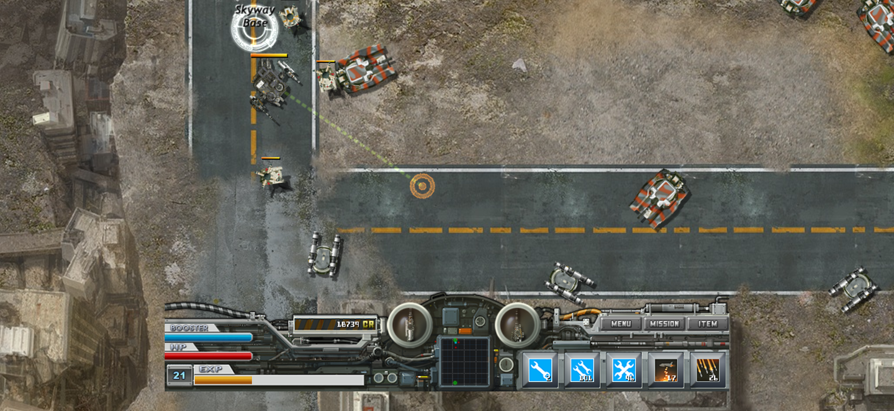

# HeavyMach 2 Restoration

[한국어](README.md) | [English](README.en.md)

[](docs/public/release-policy.md)
[](docs/en/public/build-and-install.md)
[](docs/en/public/architecture.md)
[](docs/en/public/architecture.md)
[](LICENSE-SCOPE.en.md)

[Quick Play](docs/en/public/quick-play.md) · [Quick Play](#quick-play) · [Features](#restored-from-the-original) · [Developer's statement](docs/RESTORATION.md) · [Documentation](docs/en/public/index.md)

## Why I am restoring HeavyMach 2

HeavyMach influenced my decision to become a developer. I encountered it on an iPod touch in college and later created a US App Store account to buy it. Now that I am a developer, I wanted to make the game that once showed me a direction work again.

After restoring HeavyMach 1, I am continuing with HeavyMach 2, another work in the series by developer Byun Hae-jun and illustrator Park Jae-cheol. This project aims to preserve the original game and illustrations and make them playable on current devices.

I began the restoration with the original standard and HD builds of HeavyMach 2 that I downloaded from the [HeavyMach series collection on the Internet Archive](https://archive.org/details/heavy-mach-archive_202406). I used HD 1.0.3 as the reference for the game’s behavior and data, and compared the iPhone display and touch controls with standard edition 2.0.1.

I have no intention of making money from this restoration. I also want to record how the game was restored and what was fixed.

If a stakeholder contacts me, I will take this project down.

**[HeavyMach 2 developer's statement in Korean](docs/RESTORATION.md)** · [Earlier series statement in Korean](docs/series-restoration-background.md) · [English excerpts on the earlier restorations](docs/en/RESTORATION.md)

## Reflections After Restoring the Trilogy. I Have Fulfilled My Duty to the Two Creators.

This has nothing to do with what I felt while restoring the trilogy, but I’ve noticed something after meeting some of these people nowadays, the ones who fall short of being conscientious, decent members of society. Their brains are rotting because they’ve forgotten that a person can die in an instant. In Angeles, in the Philippines, I learned that death comes without warning and takes the head of even the most arrogant. I also learned that who gets reaped has nothing to do with good or evil. Then I felt that it was my turn, and that I had even less time than I’d expected. That’s why I decided to restore the HeavyMach trilogy. To restore, while I still had some presence of mind, the software that had extended my life. Today, with HeavyMach 2 the last of the three to be restored, HeavyMach 1, MachDefense, and HeavyMach 2 all run on every platform except Windows and have reached a point where they can be maintained. I believe I have fulfilled my duty to Byun Hae-jun, the developer, and Park Jae-cheol, the illustrator, who gave me the extra time to live that even my Creator had refused to grant me.

## About the project

In HeavyMach 2, you assemble a mech, draw a route across the battlefield and fight along it. You can take missions at the command center and change equipment using loot and rewards. The restoration follows the original data and observed behavior. A shared C++ core runs on iPhone and iPad, Android, the installed PWA, and the Tauri Mac app. [How to play](docs/en/public/quick-play.md) · [Project documentation](docs/en/public/index.md)

<a id="play-and-install"></a>

## Quick Play

### Web and PWA

[Play in the browser](https://gelb2.github.io/HeavyMach2/) or install the game as an app. In Safari on iPhone or iPad, choose **Share → Add to Home Screen**. Open the installed icon and wait for the first resource download. [Installation by device](docs/en/public/build-and-install.md#play-the-published-builds) · [Build the PWA from source](docs/en/public/build-and-install.md#build-and-run-the-pwa)

### iPhone and iPad

Select `HeavyMach2Source` in Xcode and run it in an iPhone or iPad simulator. To install on a physical device, sign the build with your own Apple developer team. [Xcode build and device installation](docs/en/public/build-and-install.md#iphone-and-ipad)

### Android

Install the [v0.4 regular APK](https://github.com/gelb2/HeavyMach2/releases/tag/v0.4) and open **HeavyMach 2**. The [v0.1 test APK](https://github.com/gelb2/HeavyMach2/releases/tag/v0.1) installs as a separate app. [APK installation and Gradle build](docs/en/public/build-and-install.md#android)

### Mac

Extract the [v0.1 ZIP for Apple Silicon](https://github.com/gelb2/HeavyMach2/releases/download/v0.1/HeavyMach2-Tauri-Mac-v0.1-arm64.zip), move **HeavyMach 2 Desktop.app** to Applications, and open it. The app requires macOS 14 or later. [Installation](docs/en/public/build-and-install.md#play-the-published-builds) · [Build the Tauri app from source](docs/en/public/build-and-install.md#build-the-mac-app)

[Versions and releases](docs/public/release-policy.md)

### Verification by platform

| Platform | Installation and verification |
| --- | --- |
| PWA | The public build is v0.3. On a Galaxy, v0.2 resumed background music after returning from the Home Screen on November 21, 2026. On November 22, v0.3 launched full screen from the Home Screen icon and stayed full screen after returning. Both editions installed in Mac Chrome also reopened offline with saves intact. [v0.2 check](docs/pwa-lifecycle-audit-20261121.md#갤럭시-설치-앱) · [v0.3 check](docs/pwa-lifecycle-audit-20261121.md#갤럭시-v03-설치-앱-확인) |
| iPhone and iPad | Build v0.4 from source and sign with your own development team. The regular app was installed and relaunched on an iPhone Air and an iPad Air, with the existing saves intact. I entered White Mountain on the physical iPhone. Simulators and host tests covered all 14 portal directions. [Build and install](docs/en/public/build-and-install.md) · [Device record](docs/white-mountain-dual-release-20261120.md) · [Save checks](docs/save-transfer.md#호스트별-확인-범위) |
| Android | The regular APK is v0.4 and the test APK is v0.1. Both editions ran on a Galaxy using an iPad save to check the shop, command center, and battlefield. The v0.4 update kept the existing saves and opened the recovery-code entry screen. Applying a code and relaunching were checked in the regular app on an emulator. [Galaxy play](Android/검증-20261120.md) · [Save checks](docs/save-transfer.md#호스트별-확인-범위) |
| Tauri Mac | The public download is the v0.1 ZIP for Apple silicon. On a Mac mini, the signed public app opened in a portrait window, created a slot, and made a round trip between the base and the shop. A regular build from a public clone moved the mech in the field and kept its save after relaunch. [Public app check](docs/public/release-policy.md#v01-공개-배포-확인) · [Source build check](docs/en/public/validation.md#public-source-build) |

The regular and test editions share the core and original title artwork and keep separate saves. Test controls differ by platform. [Verification status](docs/todo.md#현재-체크--2026-11-21) · [Test editions](docs/validation-build.md#플랫폼별-치트-실행) · [Reference app](Compatibility/README.md)

### Start at level 22 with a recovery code

Use the [level 22 recovery code](docs/public/saves/level-22.txt) to start with **366,785 EXP** and **38,417 Cr** in slot 1. Base and mission progress start from the beginning. The code replaces all three slots, so open the save transfer menu on the slot screen and copy your current code first. [How to restore the code and what was tested](docs/en/public/quick-play.md#start-at-level-22-with-a-recovery-code)

In the regular v0.2 PWA installed through Chrome on Mac, slot 1 kept **level 22 and 366,785 EXP** after an offline relaunch. The restored slot opened at Ruin Field Base.

## Preparing from source

On an Apple Silicon Mac, install Xcode and Python 3.11 or later. Clone the project and prepare its campaign resources.

```sh
git clone https://github.com/gelb2/HeavyMach2.git
cd HeavyMach2
python3 tools/prepare_build_resources.py
```

The preparation command downloads and verifies the resources from a pinned public PWA build. For iPhone and iPad simulators, build OpenAL with CMake and open the Xcode project.

```sh
python3 tools/build_openal.py --sdk iphonesimulator
open Apple/iOS/HeavyMach2.xcodeproj
```

In Xcode, select `HeavyMach2Source` and an iPhone or iPad simulator. [iOS build and signing](docs/en/public/build-and-install.md#iphone-and-ipad) · [Android](docs/en/public/build-and-install.md#android) · [PWA](docs/en/public/build-and-install.md#build-and-run-the-pwa) · [Mac](docs/en/public/build-and-install.md#build-the-mac-app)

## Restored from the original

Tap the ground to move, draw a path, or double-tap to dash using booster power. The original data supplies the attachment points for the body, lower body and weapons. Combat, BOTs, equipment, purchases, missions and rewards follow the HD rules. The standard iPhone edition is also a reference for phone menu coordinates and artwork. [Original features and evidence](docs/en/public/features.md#restored-from-the-original)

The game uses the original base, battlefield and equipment art and reuses prepared textures for the parts and their shadows. The original WAV samples play through OpenAL. [Graphics and audio restoration](docs/graphics-audio-fidelity-20261110.md)

## My contributions

**White Mountain.** I asked for a campaign that uses the six unused snow illustrations and the existing base artwork. I specified that bosses should be away from portals and asked for more varied enemy groups. I also directed the work to give 25 existing weapons an acquisition path and to make the laser air strike and collector BOTs usable in normal play. [White Mountain and unused content](docs/en/public/features.md#opening-white-mountain-to-players)

**Android, PWA and Mac.** I asked the Android app to import the shared modules while preserving the files used by Apple apps. Each platform handles its system connections. The new recovery code transfers progress and equipment across all three save slots. I set the scope and reported defects, and worked with Codex on implementation and automated checks. [Platform development](docs/en/public/development-history.md#android-web-mac-and-save-transfer) · [Transfer saves](docs/save-transfer.md)

Take the White Mountain portal in Desert 01, then choose **Snow Pass** at the base. The screenshot shows arrival in Snow Pass in the cheat build on an iPhone simulator. [Base entry, bosses, and equipment in play](docs/en/public/gameplay-gallery.md#white-mountain-base-and-snowfields)


## Gameplay screenshots and clips


Eight continuous seconds from the iPad recording show the player moving a mech between ponds while fighting nearby tanks.


The iPhone screenshot shows a waypoint on the road near the Skyway Base portal, with the HUD along the bottom.



[More combat footage, iPhone command and shop screens, a White Mountain boss, Galaxy and PWA gameplay](docs/en/public/gameplay-gallery.md)

## Verified behavior and remaining work

Each iPhone and iPad simulator test run covered 126 scenarios over 2,100 frames. Both simulators also checked 14 White Mountain portal directions, four boss missions and 29 equipment scenarios. White Mountain routes and command on a physical iPad, installed Safari offline restart, Mac command and audio, E-10 completion notifications, collection rewards and the final HD comparison remain open. [Evidence by feature](docs/feature-verification.md) · [Current TODO](docs/todo.md#현재-체크--2026-11-21)

## Implementation and restoration rules

The C++20 core shares the original-format readers, part assembly, game rules and UI. The Apple host uses Objective-C++; game graphics use OpenGL ES, effects use OpenAL Soft, and BGM uses AudioQueue. The original source code has not been obtained. New source is written from evidence in the executable, data and observed behavior.

Firing does not create a file/database write or a new audio context for each shot. Original and new parts follow the shared data, assembly and rendering paths. Ads are neither displayed nor requested.

[Technology and asset procedures](docs/technology-and-assets.md) · [Runtime, saves and audio](docs/runtime-contract.md) · [Reused code sources](docs/source-reuse.md)

## Troubleshooting

**Shop and iPhone movement.** I reported problems in the shop and movement code that Codex implemented for the restoration. I asked to measure the original shop's controls, slots and item details again. I reported failed jumps after drawing a new route, Skyway layer jitter, apparent empty inventory slots, and a missing laser air strike in the iPad shop. [Fixes and tests](docs/en/public/troubleshooting.md)

[Troubleshooting in Korean](docs/en/public/troubleshooting.md) · [Development history in Korean](docs/en/public/development-history.md)

## How I directed and tested the work

[How I directed the work](docs/en/public/development-history.md#how-i-directed-the-work-and-tested-it) · [Testing method](docs/en/public/testing-method.md)

## Code structure and versions

[Code structure in Korean](docs/en/public/architecture.md) · [Validation](docs/en/public/validation.md) · [Changelog](CHANGELOG.md) · [Release policy](docs/public/release-policy.md)

## Licenses and resources

Byun Hae-jun developed the original game, and Park Jae-cheol created its artwork. New restoration code uses the [MIT License](LICENSE). Original artwork, audio and data, and third-party code have separate terms. [License scope](LICENSE-SCOPE.en.md) · [Credits and third-party notices](CREDITS.md)

## An Additional Statement Clarifying the Purpose of This Project

After briefly examining the public activity of a recent visitor to the MachDefense repository and tracing their activity in other repositories, I felt I needed to make the purpose of these repositories clear: HeavyMach, MachDefense, and—if I am still alive to restore it—HeavyMach2. That is why I am leaving this statement.

I have screenshots and an analysis of that activity. An ordinary person, or someone who has only lived in societies where law and morality hold, might dismiss my thinking as circumstantial or speculative. 

But I consider what has just happened to me to be, in CIA terminology, actionable intelligence. That is why I am leaving this statement.

I have no intention of making money from this.

But if you are reading this repository with the intention of doing more than porting it for your own enjoyment—if you intend to put it on the App Store or Steam, sell courses while pretending that you restored it, or hand it over to a third-party sales channel—then I have something to say to you.

I am not good at predicting favorable turns in my own future or finances. But I am better at recognizing bad omens than you might think. Those events include two declarations of martial law in South Korea and the war between Ukraine and Russia in Europe.

If you put this on an official marketplace or hand it over to a third-party sales channel, the consequences that follow will be difficult for one individual to bear.

I do not have much time left to live. I do not know how much time you have left, but do not let greed hasten your own death. Even if it is not me, someone else might shorten your life.

