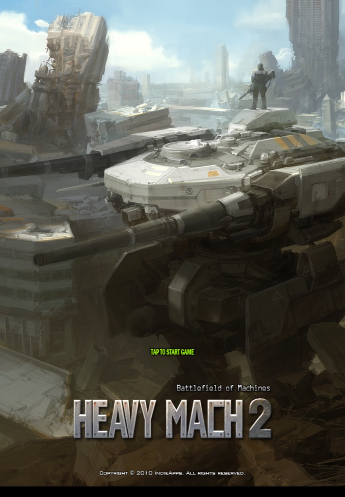
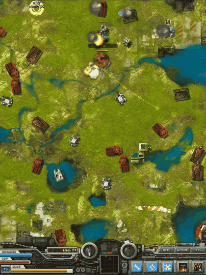

# HeavyMach 2 Restoration

[한국어](README.md) | [English](README.en.md)

[Quick Play](docs/en/public/quick-play.md) · [Build and install](docs/en/public/build-and-install.md) · [Features](#restored-from-the-original) · [Developer's statement](docs/RESTORATION.md) · [Documentation](docs/en/public/index.md)

## Why I am restoring HeavyMach 2

HeavyMach influenced my decision to become a developer. I encountered it on an iPod touch in college and later created a US App Store account to buy it. Now that I am a developer, I wanted to make the game that once showed me a direction work again.

After restoring HeavyMach 1, I am continuing with HeavyMach 2, another work in the series by developer Byun Hae-jun and illustrator Park Jae-cheol. This project aims to preserve the original game and illustrations and make them playable on current devices.

I have no intention of making money from this restoration. I also want to record how the game was restored and what was fixed.

**[HeavyMach 2 developer's statement in Korean](docs/RESTORATION.md)** · [Earlier series statement in Korean](docs/series-restoration-background.md) · [English excerpts on the earlier restorations](docs/en/RESTORATION.md)

## About the project

In HeavyMach 2, you assemble a mech, draw a route across the battlefield and fight along it. You can take missions at the command center and change equipment using loot and rewards. The restoration follows the original data and observed behavior. A shared C++ core runs on iPhone and iPad, Android, the installed PWA, and the Tauri Mac app. [How to play](docs/en/public/quick-play.md) · [Project documentation](docs/en/public/index.md)

## Play and install

**[Open the PWA](https://gelb2.github.io/HeavyMach2/)** · **[Android regular APK](https://github.com/gelb2/HeavyMach2/releases/tag/v0.4)** · **[Mac app](https://github.com/gelb2/HeavyMach2/releases/tag/v0.1)** · [Build and installation instructions](docs/en/public/build-and-install.md)

[Install the PWA from the Home Screen](docs/public/build-and-install.md#pwa-설치) or [extract and open the Tauri Mac app](docs/public/build-and-install.md#tauri-mac-앱-받기). [Version and release policy](docs/public/release-policy.md)

| Platform | Installation and verification |
| --- | --- |
| iPhone and iPad | Landscape on iPhone and portrait on iPad. Both physical devices received the regular app and the save recording base visits. I entered White Mountain on the iPhone. All 14 portal directions were checked in simulators and host tests. [Build and install](docs/public/build-and-install.md) · [Device record](docs/white-mountain-dual-release-20261120.md) |
| Android | Both Galaxy editions used the same iPad save. The shop, command, battle and a short play session were checked. The Android port is in `develop`. [Build and install](docs/public/build-and-install.md#android-빌드와-설치) · [Device record](Android/검증-20261120.md) |
| PWA | Mac Chrome reopened both installed editions offline with saves intact. On a Galaxy, the public v0.2 installed app returned from the Home Screen in landscape and resumed background music. [Build the PWA](docs/en/public/build-and-install.md#build-and-run-the-pwa) · [Galaxy checks](docs/pwa-lifecycle-audit-20261121.md) |
| Tauri Mac | Both bundles from a fresh clone passed signature verification. The regular app entered the base and field, moved the mech, and retained its slot after relaunch. [Build the Mac app](docs/en/public/build-and-install.md#build-the-mac-app) · [Clean-clone checks](docs/en/public/validation.md#public-source-build) |

The regular and test editions share the core and original title artwork and keep separate saves. Test controls differ by platform. [Verification status](docs/todo.md#현재-체크--2026-11-21) · [Test editions](docs/validation-build.md#플랫폼별-치트-실행) · [Reference app](Compatibility/README.md)

### Start at level 22 with a recovery code

Use the [level 22 recovery code](docs/public/saves/level-22.txt) to start with **366,785 EXP** and **38,417 Cr** in slot 1. Base and mission progress start from the beginning. The code replaces all three slots, so open the save transfer menu on the slot screen and copy your current code first. [How to restore the code and what was tested](docs/en/public/quick-play.md#start-at-level-22-with-a-recovery-code)

In the regular v0.2 PWA installed through Chrome on Mac, slot 1 kept **level 22 and 366,785 EXP** after an offline relaunch. The restored slot opened at Ruin Field Base.

## Preparing from source

On an Apple Silicon Mac, install Xcode and Python 3.11 or later. Clone the project and prepare its campaign resources.

```sh
git clone https://github.com/gelb2/HeavyMach2.git
cd HeavyMach2
python3 tools/prepare_build_resources.py
```

The preparation command downloads and verifies the resources from a pinned public PWA build. For iPhone and iPad simulators, build OpenAL with CMake and open the Xcode project.

```sh
python3 tools/build_openal.py --sdk iphonesimulator
open Apple/iOS/HeavyMach2.xcodeproj
```

In Xcode, select `HeavyMach2Source` and an iPhone or iPad simulator. [iOS build and signing](docs/en/public/build-and-install.md#iphone-and-ipad) · [Android](docs/en/public/build-and-install.md#android) · [PWA](docs/en/public/build-and-install.md#build-and-run-the-pwa) · [Mac](docs/en/public/build-and-install.md#build-the-mac-app)

## Restored from the original

Tap the ground to move, draw a path, or double-tap to dash using booster power. The original data supplies the attachment points for the body, lower body and weapons. Combat, BOTs, equipment, purchases, missions and rewards follow the HD rules. The standard iPhone edition is also a reference for phone menu coordinates and artwork. [Original features and evidence](docs/public/features.md#원작에서-복원한-것)

The game uses the original base, battlefield and equipment art and reuses prepared textures for the parts and their shadows. The original WAV samples play through OpenAL. [Graphics and audio restoration](docs/graphics-audio-fidelity-20261110.md)

## My contributions

**White Mountain.** I asked for a campaign that uses the six unused snow illustrations and the existing base artwork. I specified that bosses should be away from portals and asked for more varied enemy groups. I also directed the work to give 25 existing weapons an acquisition path and to make the laser air strike and collector BOTs usable in normal play. [White Mountain and unused content](docs/public/features.md#화이트마운틴에-실제로-들어갈-수-있게-만들었다)

**Shop and iPhone movement.** I asked to measure the original shop's controls, slots and item details again. I reported failed jumps after drawing a new route, Skyway layer jitter, apparent empty inventory slots, and a missing laser air strike in the iPad shop. [Fixes and tests](docs/public/features.md#iphone에서-본-화면과-입력-문제를-고쳤다)

**Android, PWA and Mac.** I asked the Android app to import the shared modules while preserving the files used by Apple apps. Each platform handles its system connections. The new recovery code transfers progress and equipment across all three save slots. I set the scope and reported defects, and worked with Codex on implementation and automated checks. [Platform development](docs/public/development-history.md#android웹mac과-저장-이동) · [Transfer saves](docs/save-transfer.md)

## Gameplay screenshots and clips



Eight continuous seconds from the iPad recording show the player moving a mech between ponds while fighting nearby tanks.



The iPhone screenshot shows a waypoint on the road near the Skyway Base portal, with the HUD along the bottom.


[More combat footage, iPhone command and shop screens, a White Mountain boss, Galaxy and PWA gameplay](docs/public/gameplay-gallery.md)

## Verified behavior and remaining work

Each iPhone and iPad simulator test run covered 126 scenarios over 2,100 frames. Both simulators also checked 14 White Mountain portal directions, four boss missions and 29 equipment scenarios. White Mountain routes and command on a physical iPad, installed Safari offline restart, Mac command and audio, E-10 completion notifications, collection rewards and the final HD comparison remain open. [Evidence by feature](docs/feature-verification.md) · [Current TODO](docs/todo.md#현재-체크--2026-11-21)

## Implementation and restoration rules

The C++20 core shares the original-format readers, part assembly, game rules and UI. The Apple host uses Objective-C++; game graphics use OpenGL ES, effects use OpenAL Soft, and BGM uses AudioQueue. The original source code has not been obtained. New source is written from evidence in the executable, data and observed behavior.

Firing does not create a file/database write or a new audio context for each shot. Original and new parts follow the shared data, assembly and rendering paths. Ads are neither displayed nor requested.

[Technology and asset procedures](docs/technology-and-assets.md) · [Runtime, saves and audio](docs/runtime-contract.md) · [Reused code sources](docs/source-reuse.md)

## Problems fixed during development

[Troubleshooting in Korean](docs/public/troubleshooting.md) · [Development history in Korean](docs/public/development-history.md)

## How I directed and tested the work

[How I directed the work](docs/public/development-history.md#내가-일을-시키고-테스트한-방법) · [Testing method in Korean](docs/public/testing-method.md)

## Code structure and versions

[Code structure in Korean](docs/public/architecture.md) · [Validation](docs/en/public/validation.md) · [Changelog](CHANGELOG.md) · [Release policy](docs/public/release-policy.md)

## Licenses and resources

Byun Hae-jun developed the original game, and Park Jae-cheol created its artwork. New restoration code uses the [MIT License](LICENSE). Original artwork, audio and data, and third-party code have separate terms. [License scope](LICENSE-SCOPE.en.md) · [Credits and third-party notices](CREDITS.md)

## An Additional Statement Clarifying the Purpose of This Project

Before restoring HeavyMach 2, I briefly examined the public activity of a visitor to the MachDefense repository and traced their activity in other repositories. I felt I needed to make the purpose of HeavyMach, MachDefense, and HeavyMach 2 clear. That is why I am leaving this statement.

I have screenshots and an analysis of that activity. An ordinary person, or someone who has only lived in societies where law and morality hold, might dismiss my thinking as circumstantial or speculative.

But I consider what I observed at the time to be, in CIA terminology, actionable intelligence. That is why I am leaving this statement.

I have no intention of making money from this.

I ask that you do not port this restoration for sale on the App Store or Steam, sell courses claiming you restored it, or pass it on to third-party sales channels. The [license scope](LICENSE-SCOPE.en.md) explains the terms for new restoration code and original material.

[Developer’s statement in Korean](docs/RESTORATION.md#내가-이-복원으로-남기려는-것)
