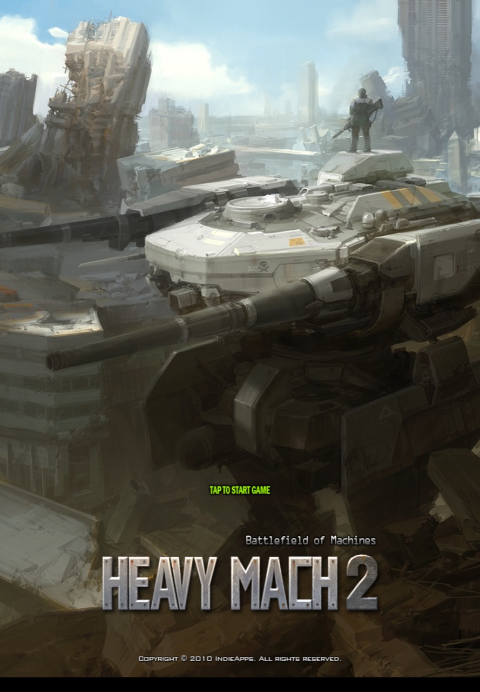
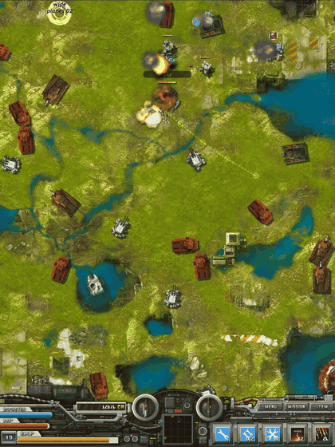
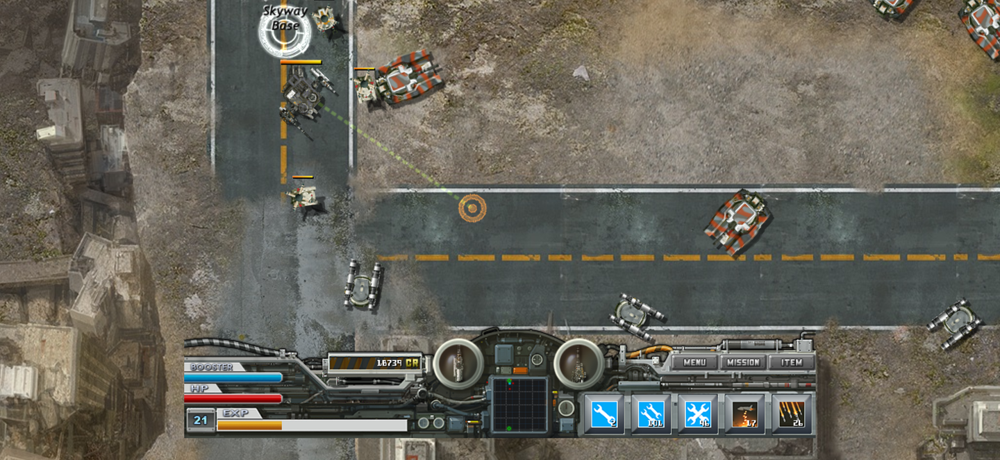

# HeavyMach 2 복원

[한국어](README.md) | [English](README.en.md)

[](docs/public/release-policy.md)
[](docs/public/build-and-install.md)
[](docs/public/architecture.md)
[](docs/public/architecture.md)
[](LICENSE-SCOPE.md)

[플레이 방법](docs/public/quick-play.md) · [Quick Play](#quick-play) · [기능과 추가 작업](docs/public/features.md) · [개발자의 변](docs/RESTORATION.md) · [전체 문서](docs/README.md)

## HeavyMach 2를 다시 만드는 이유

HeavyMach는 내가 개발자로 직업을 바꾸는 데 영향을 준 게임이다. 대학생 시절 아이팟터치에서 이 게임을 만났고, 나중에는 미국 앱스토어 계정을 만들어 구매했다. 한때 내게 방향을 보여준 게임을, 개발자가 된 내가 다시 작동하게 만들고 싶었다.

HeavyMach 1을 복원한 뒤, 개발자 변해준과 일러스트레이터 박재철의 연작인 HeavyMach 2의 복원을 이어가고 있다. 원작자의 게임과 일러스트를 보존하고, 현재 기기에서 다시 플레이할 수 있게 만드는 것이 이 프로젝트의 목적이다.

나는 Internet Archive의 [HeavyMach 시리즈 모음](https://archive.org/details/heavy-mach-archive_202406)에서 헤비멕2 일반판과 HD판의 원본 빌드를 받아 복원을 시작했다. 게임 동작과 데이터는 HD 1.0.3을 기준으로 삼았고, iPhone의 화면과 터치 조작은 일반판 2.0.1과 비교했다.

나는 이 복원판으로 돈을 벌 생각이 없다. 이 게임을 어떻게 복원했고 무엇을 고쳤는지도 기록으로 남기려 한다.

이해관계자가 연락하면 이 프로젝트는 내릴 것이다.

**[개발자의 변](docs/RESTORATION.md)** · [이전 시리즈 복원 회고](docs/series-restoration-background.md)

## 3부작 복원 후의 소회. 나는 두 제작자에게 의무를 다 했다.

내가 3부작을 복원하며 느낀 것과 상관없는 것이다만, 내가 요즘것들, 그러니까 제대로 착실하게 인의를 다하는 사회인 말고 그렇지 않은 것들을 만나고 느낀게 있다. 사람은 순식간에 죽는다는 사실을 망각해서 뇌가 썩어가고 있다는 것이다. 나는 필리핀 앙헬레스에서 죽음은 예고없이, 가장 오만한 사람의 목을 친다는걸 배웠고, 누가 수확당하냐는 선악과 상관 없다는 것도 배웠다. 그리고, 이제 내 차례라는, 내 예상보다 시간이 더 부족하다는걸 느꼈다. 그렇기에 나는 헤비멕 시리즈 3부작을 복원하기로 했다. 내가 조금이라도 제정신일때 내 수명을 연장해준 소프트웨어를 복원하는 것. 그리고 오늘, 헤비멕2를 마지막으로 헤비멕1, 맥디펜스, 헤비멕2 3개 소프트웨어는 윈도우를 제외한 모든 플랫폼에서 동작하며, 유지보수 가능한 수준으로 올라왔다. 나는, 나에게 창조주조차 추가할당을 거부한 추가 수명을 할당해 준 변해준 개발자와 박재철 일러스트레이터에 대한 의무를 다했다고 생각한다.

## 프로젝트 소개

HeavyMach 2는 메크를 조립하고 전장에서 이동 경로를 그어 싸우는 게임이다. 기지의 사령부에서 임무를 받고 전리품과 보상으로 장비를 바꾼다. 원본 실행 기록과 데이터에서 이 동작을 복원했다. C++ 공통 코어를 iPhone·iPad, Android, 설치형 PWA와 Tauri Mac에서 사용한다. [플레이와 조작](docs/public/quick-play.md) · [현행 정본](docs/canonical.md)

<a id="플레이와-설치"></a>

## Quick Play

### 웹·PWA

[웹에서 바로 플레이](https://gelb2.github.io/HeavyMach2/)하거나 앱으로 설치한다. iPhone·iPad에서는 Safari의 **공유 → 홈 화면에 추가**를 사용한다. 설치한 아이콘으로 열고 첫 자원 다운로드가 끝나면 플레이한다. [기기별 설치](docs/public/build-and-install.md#pwa-설치) · [소스에서 PWA 빌드](docs/public/build-and-install.md#pwa-빌드와-로컬-실행)

### iPhone·iPad

Xcode에서 `HeavyMach2Source`를 선택해 iPhone·iPad 시뮬레이터에서 실행한다. 실제 기기에 설치할 때는 본인의 Apple 개발 팀으로 서명한다. [Xcode 빌드](docs/public/build-and-install.md#iphoneipad-시뮬레이터-빌드) · [실기기 설치](docs/public/build-and-install.md#실제-iphoneipad에-설치)

### Android

[정식 APK v0.4](https://github.com/gelb2/HeavyMach2/releases/tag/v0.4)를 설치해 **HeavyMach 2**를 연다. [치트 APK v0.1](https://github.com/gelb2/HeavyMach2/releases/tag/v0.1)은 별도 앱이다. [APK 설치와 Gradle 빌드](docs/public/build-and-install.md#android-빌드와-설치)

### Mac

[Apple Silicon용 Mac ZIP v0.1](https://github.com/gelb2/HeavyMach2/releases/download/v0.1/HeavyMach2-Tauri-Mac-v0.1-arm64.zip)을 풀고 **HeavyMach 2 Desktop.app**을 응용 프로그램 폴더에 옮겨 실행한다. macOS 14 이상이 필요하다. [앱 설치와 첫 실행](docs/public/build-and-install.md#tauri-mac-앱-받기) · [소스에서 Tauri 빌드](docs/public/build-and-install.md#tauri-mac-빌드)

[버전과 배포 기준](docs/public/release-policy.md)

### 플랫폼별 검증

| 플랫폼 | 설치와 현재 확인한 범위 |
| --- | --- |
| PWA | Mac Chrome 설치 앱의 오프라인 재실행과 저장 유지를 확인했다. 갤럭시의 공개 v0.2 설치 앱은 홈 복귀 뒤 가로 화면과 배경음을 이어갔다. [로컬 빌드](docs/public/build-and-install.md#pwa-빌드와-로컬-실행) · [갤럭시 검사](docs/pwa-lifecycle-audit-20261121.md) |
| iPhone·iPad | iPhone 가로·iPad 세로. 두 실기기에 정식판과 기지 방문 저장을 넣었다. 내가 iPhone에서 화이트마운틴 진입을 확인했다. 포털 14방향은 시뮬레이터와 호스트에서 확인했다. [빌드와 설치](docs/public/build-and-install.md) · [실기기 기록](docs/white-mountain-dual-release-20261120.md) |
| Android | 갤럭시 정식·치트판에 같은 iPad 저장을 적용했다. 상점·사령부·전장과 짧은 실제 플레이를 확인했다. Android 포팅은 `develop`에 병합됐다. [APK 빌드와 설치](docs/public/build-and-install.md#android-빌드와-설치) · [기기 기록](Android/검증-20261120.md) |
| Tauri Mac | 공개 클론에서 정식·치트 번들의 서명을 확인했다. 정식판에서 기지와 전장으로 들어가 이동하고 게임을 다시 열어 같은 슬롯을 확인했다. [Mac 앱 빌드](docs/public/build-and-install.md#tauri-mac-빌드) · [클론 실행 검사](docs/public/validation.md#공개-클론에서-빌드와-실행) |

정식판과 치트판은 공통 코어와 원본 탭투스타트 그림을 사용하고 저장은 분리한다. 치트판은 플랫폼마다 실행 방식이 다르다. 원본 실행을 비교할 때는 별도 포팅판을 쓴다. [검증 현황](docs/todo.md#현재-체크--2026-11-21) · [치트 앱 실행](docs/validation-build.md#플랫폼별-치트-실행) · [원작 비교용 포팅판](Compatibility/README.md)

### 복구코드로 레벨 22부터 시작하기

[레벨 22 복구코드](docs/public/saves/level-22.txt)를 넣으면 1번 슬롯에서 **366,785 EXP**와 **38,417 Cr**로 시작할 수 있다. 기지와 임무는 처음부터 진행한다. 복구는 슬롯 세 개를 모두 교체하므로, 슬롯 화면의 **저장 이동**에서 기존 코드를 먼저 복사해 보관한다. [적용 방법과 확인 결과](docs/save-transfer.md#복구코드로-레벨-22부터-시작하기)

Mac Chrome에 설치한 정식 PWA v0.2에서 복구 후 **레벨 22·366,785 EXP**가 오프라인 재실행 뒤에도 유지되고, 같은 슬롯으로 Ruin Field Base에 들어가는 것을 확인했다.

## 소스에서 준비하기

Apple Silicon Mac에서 Xcode와 Python 3.11 이상을 설치한 뒤 소스와 캠페인 자원을 받는다.

```sh
git clone https://github.com/gelb2/HeavyMach2.git
cd HeavyMach2
python3 tools/prepare_build_resources.py
```

준비 명령은 공개 PWA의 고정 버전에서 게임 자원을 받아 검증한다. iPhone·iPad 시뮬레이터는 CMake로 OpenAL을 빌드한 뒤 Xcode 프로젝트를 연다.

```sh
python3 tools/build_openal.py --sdk iphonesimulator
open Apple/iOS/HeavyMach2.xcodeproj
```

Xcode에서 `HeavyMach2Source`와 iPhone 또는 iPad 시뮬레이터를 선택해 실행한다. [iOS 빌드와 기기 서명](docs/public/build-and-install.md#iphoneipad-시뮬레이터-빌드) · [Android](docs/public/build-and-install.md#android-빌드와-설치) · [PWA](docs/public/build-and-install.md#pwa-빌드와-로컬-실행) · [Mac](docs/public/build-and-install.md#tauri-mac-빌드)

## 원작에서 복원한 것

땅을 눌러 이동하고 경로를 그으며 두 번 탭해 부스터로 급속 이동한다. 몸통·하체·무기는 원작 데이터의 기준점에 조립한다. 무기 발사와 피해, BOT, 상점과 정비, 임무 수락·보상·저장에는 HD판의 규칙을 사용한다. iPhone 메뉴 그림과 좌표는 일반판도 대조했다. [원작 기능과 근거](docs/public/features.md#원작에서-복원한-것)

기지·전장·장비 그림과 효과음은 확인한 원본을 사용한다. 파츠 그림과 그림자는 준비한 텍스처를 재사용하고, WAV 효과음은 원작 샘플을 OpenAL로 재생한다. [그래픽·음향 복원](docs/graphics-audio-fidelity-20261110.md)

## 내가 한 일

**화이트마운틴.** 원작에 남은 설원 그림 여섯 장과 기지 그림으로 새 전장과 포털을 만들도록 했다. 보스는 포털에서 떨어뜨리고 전장별 적 구성을 늘렸다. 의뢰·보상과 기존 무기 25종의 입수 경로, 레이저 공습과 수집형 BOT을 연결하도록 했다. [화이트마운틴과 미등장 콘텐츠](docs/public/features.md#화이트마운틴에-실제로-들어갈-수-있게-만들었다)

**상점과 iPhone 이동.** 원본 상점의 버튼·슬롯·상세창 크기를 다시 대조하게 했다. 경로를 다시 그린 뒤 점프가 실패하는 경우, Skyway 레이어가 떨리는 경우, 인벤토리의 빈칸처럼 보이는 칸과 iPad 특수공격 탭의 레이저 공습 누락도 보고했다. [상점·이동 수정과 검사](docs/public/features.md#iphone에서-본-화면과-입력-문제를-고쳤다)

**Android·PWA·Mac.** Android는 Apple 앱이 쓰는 파일을 수정하지 않고 공통 모듈을 가져다 쓰도록 했다. 터치·음향 장치 같은 연결은 해당 플랫폼에 뒀다. 복구코드를 추가해 세 슬롯의 진행과 장비를 함께 옮길 수 있게 했다. 나는 작업 범위와 결함을 정리했고, Codex와 구현과 자동 검사를 만들었다. [플랫폼 확장](docs/public/development-history.md#android웹mac과-저장-이동) · [복구코드 사용법](docs/save-transfer.md)

## 플레이 화면과 영상



iPad 세로 화면에서 플레이어가 연못 사이로 메크를 이동시키며 주변 전차와 교전한다. 바탕화면에 있던 플레이 녹화에서 연속 8초를 발췌했다.



아래는 Skyway Base 포털 주변의 iPhone 가로 화면이다. 도로 위 이동 목표와 화면 하단 HUD가 보인다.



[다른 전투 GIF, iPhone 사령부와 상점, 설원 보스, 갤럭시와 PWA 갤러리](docs/public/gameplay-gallery.md)

## 확인한 동작과 남은 과제

iPhone·iPad 시뮬레이터의 치트 앱에서 각각 126조건·2,100프레임을 실행했다. 화이트마운틴 포털 14방향·보스 의뢰 4건·장비 29건도 두 시뮬레이터에서 따로 확인했다. 실물 iPad의 설원 출입과 사령부, Safari 설치판 오프라인 재시작, Mac의 사령부와 음향, E-10 달성 알림·수집 보상과 원작 HD의 최종 일괄 대조는 남아 있다. [실행 근거](docs/feature-verification.md) · [현재 TODO](docs/todo.md#현재-체크--2026-11-21)

## 구현과 복원 기준

C++20 코어에서 원작 데이터 reader, 파츠 조립, 게임 규칙과 UI를 공유한다. Apple 호스트는 Objective-C++이며, 게임 그림은 OpenGL ES, 효과음은 OpenAL Soft, BGM은 AudioQueue 경로로 출력한다. 원작 소스코드는 확보하지 못했으며, 바이너리·데이터·실행 관측을 근거로 새 소스를 작성한다.

사격마다 파일·DB를 쓰거나 오디오 컨텍스트를 만들지 않는다. 원본 파츠와 신규 파츠는 공통 데이터·조립·렌더 경로를 따른다. 광고를 표시하거나 요청하지 않는다.

[기술스택·에셋 절차](docs/technology-and-assets.md) · [실행·저장·음향 계약](docs/runtime-contract.md) · [기존 복원 코드의 출처](docs/source-reuse.md)

## 개발 중 고친 문제

[트러블슈팅](docs/public/troubleshooting.md) · [분석·구현·검증 과정](docs/public/development-history.md)

## 나는 이렇게 일을 시키고 테스트했다

[내가 일을 시킨 방법](docs/public/development-history.md#내가-일을-시키고-테스트한-방법) · [테스트 방법](docs/public/testing-method.md)

## 코드 구조와 버전

[코드 구조](docs/public/architecture.md) · [검증](docs/public/validation.md) · [변경 이력](CHANGELOG.md) · [버전과 배포](docs/public/release-policy.md) · [기여 안내](CONTRIBUTING.md)

## 라이선스와 자원

원작은 변해준이 개발하고 박재철이 그림을 맡았다. 복원을 위해 새로 작성한 코드는 [MIT](LICENSE)를 적용한다. 원작 그림·음원·데이터와 외부 코드의 적용 조건은 별도로 확인할 수 있다. [코드 라이선스 범위](LICENSE-SCOPE.md) · [제작자와 외부 코드](CREDITS.md)

## 이 프로젝트의 존재 목적을 확실히 하기 위한 추가 문건

최근 맥디펜스 레포지토리에 방문한 방문객의 활동 내역을 간략히 조사하고, 동선을 역추적하여 다른 레포지토리의 방문 이력을 살펴봤다. 그 결과, 헤비멕과 맥디펜스, 나아가 내가 숨이 더 붙어 있다면 복원하게 될 헤비멕2 레포지토리의 존재 목적에 대해 확실히 해야 할 듯하여 별도의 문건을 남긴다.

이 프로젝트를 에뮬레이터에 집어 넣어서, 텔레그램으로 판매하여 이익을 취하려는 활동 내역에 대한 캡처와 분석을 갖고 있다. 평범한 사람이나 법과 도덕이 통용되는 사회에서만 살아본 사람이라면 나의 생각에 대해 정황증거, 억측이라고 할 수 있다.  

그러나 나에게 방금 발생한 일은 CIA식으로 표현하자면 Actionable Intelligence라고 생각한다. 그러므로 이 문건을 남긴다.

나는 이걸로 돈을 벌 생각이 없다.

그런데 이 레포지토리를 보는 당신이, 만일 이걸 그대로 포팅해서 혼자 즐기는 것이 아니라 앱스토어나 스팀에 올리거나, 당신이 복원한 척 강의를 팔거나, 제3의 판매 채널에 넘긴다면 나는 이렇게 말하고 싶다.

나는 내 미래나 내 돈과 관련한 좋은 징조는 잘 맞추지 못한다. 하지만 나는 나쁜 징조에 대해서는 당신 생각보다 잘 맞추며, 그 나쁜 일에는 대한민국에서 일어난 두 차례의 계엄령과 유럽에서 일어난 우크라이나–러시아 전쟁도 포함된다.

당신이 이것을 정식 마켓이나 제3의 판매 채널에 넘긴다면, 그 뒤의 대가는 한 개인이 감당하기 힘들 것이다.

나는 수명이 얼마 남지 않았다. 당신의 수명이 얼마인지는 모르겠으나, 돈에 눈이 멀어 당신의 명을 재촉하지 마라. 내가 아니더라도, 그 누구든 당신의 명줄을 줄여버릴지도 모르니.
