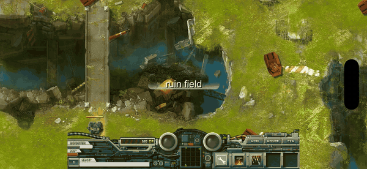
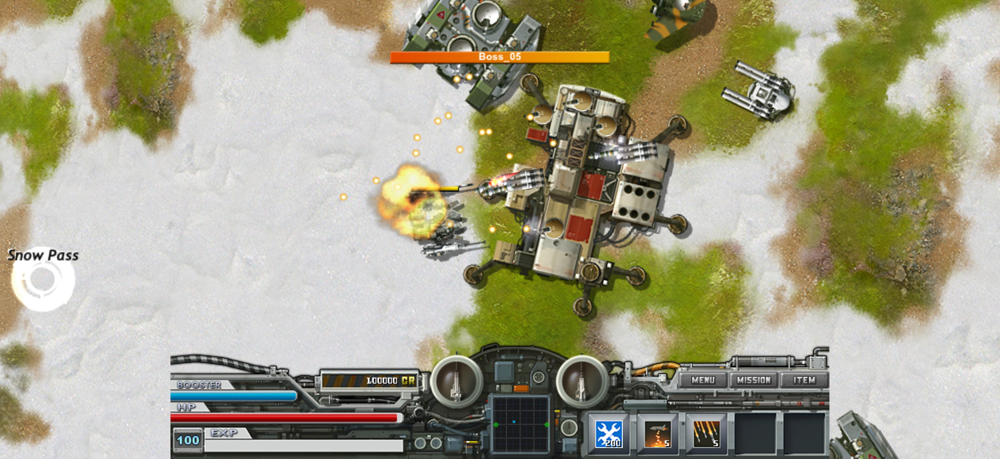

# HeavyMach 2 복원

[한국어](README.md) | [English](README.en.md)

[플레이 방법](docs/public/quick-play.md) · [플랫폼별 설치](#플레이와-설치) · [기능과 추가 작업](docs/public/features.md) · [개발자의 변](docs/RESTORATION.md) · [전체 문서](docs/README.md)

## HeavyMach 2를 다시 만드는 이유

HeavyMach는 내가 개발자로 직업을 바꾸는 데 영향을 준 게임이다. 대학생 시절 아이팟터치에서 이 게임을 만났고, 나중에는 미국 앱스토어 계정을 만들어 구매했다. 한때 내게 방향을 보여준 게임을, 개발자가 된 내가 다시 작동하게 만들고 싶었다.

HeavyMach 1을 복원한 뒤, 개발자 변해준과 일러스트레이터 박재철의 연작인 HeavyMach 2의 복원을 이어가고 있다. 원작자의 게임과 일러스트를 보존하고, 현재 기기에서 다시 플레이할 수 있게 만드는 것이 이 프로젝트의 목적이다.

나는 이 복원판으로 돈을 벌 생각이 없다. 이 게임을 어떻게 복원했고 무엇을 고쳤는지도 기록으로 남기려 한다.

**[개발자의 변 초안](docs/RESTORATION.md)**

## 프로젝트 소개

HeavyMach 2는 메크를 조립하고 전장에서 이동 경로를 그어 싸우는 게임이다. 기지의 사령부에서 임무를 받고 전리품과 보상으로 장비를 바꾼다. 원본 실행 기록과 데이터에서 이 동작을 복원했다. C++ 공통 코어를 iPhone·iPad, Android, 설치형 PWA와 Tauri Mac에서 사용한다. [플레이와 조작](docs/public/quick-play.md) · [현행 정본](docs/canonical.md)

## 플레이와 설치

| 플랫폼 | 설치와 현재 확인한 범위 |
| --- | --- |
| iPhone·iPad | iPhone 가로·iPad 세로. 두 실기기에 정식판과 기지 방문 저장을 넣었다. 내가 iPhone에서 화이트마운틴 진입을 확인했다. 포털 14방향은 시뮬레이터와 호스트에서 확인했다. [빌드와 설치](docs/public/build-and-install.md) · [실기기 기록](docs/white-mountain-dual-release-20261120.md) |
| Android | 갤럭시 정식·치트판에 같은 iPad 저장을 적용했다. 상점·사령부·전장과 짧은 실제 플레이를 확인했다. Android 포팅은 `develop`에 병합됐다. [APK 빌드와 설치](Android/README.md) · [기기 기록](Android/검증-20261120.md) |
| PWA | Mac Chrome 설치 앱의 오프라인 재실행과 저장 유지, iPhone 시뮬레이터의 홈 화면 실행을 확인했다. 실제 휴대폰·태블릿용 설치 주소와 검사는 남아 있다. [빌드와 설치](Web/README.md) · [기기별 확인](docs/pwa-device-validation-20261120.md) |
| Tauri Mac | 정식·치트 번들을 각각 빌드하고 로컬 서명을 확인했다. 이전 빌드의 820×900pt 세로 창 시작과 정식판 저장 왕복을 확인했다. [Mac 앱 빌드](Desktop/Tauri/README.md) · [세로 창 검사](docs/pwa-device-validation-20261120.md#tauri-mac-세로-창) |

빌드에는 비공개 저장소 접근과 로컬 원본이 필요하다. 복구코드·PWA·Tauri 구현은 현재 작업 브랜치에 있다. 정식판과 치트판은 공통 코어와 원본 탭투스타트 그림을 사용하고 저장은 분리한다. 치트판은 플랫폼마다 실행 방식이 다르다. 원본 실행을 비교할 때는 별도 포팅판을 쓴다. [검증 현황](docs/todo.md#현재-체크--2026-11-21) · [치트 앱 실행](docs/validation-build.md#플랫폼별-치트-실행) · [원작 비교용 포팅판](Compatibility/README.md)

## 소스에서 준비하기

Apple Silicon Mac, Xcode, Python 3.11 이상, CMake 3.20 이상, XcodeGen을 사용한다. 저장소 접근 권한과 로컬 HD 1.0.3·HD 1.0.0·iPhone 일반판 2.0.1 원본이 필요하다.

```sh
git clone git@github.com:gelb2/HeavyMach2.git
cd HeavyMach2
git config core.hooksPath .githooks
```

[원본 명세](docs/source-provenance.json)의 경로와 SHA-256을 확인한 뒤 자원·아이콘·선택한 SDK의 OpenAL을 준비한다.

```sh
python3 tools/prepare_hd_assets.py
python3 tools/prepare_phone_menu_assets.py
python3 tools/prepare_campaign_assets.py
python3 tools/prepare_app_icons.py
python3 tools/build_openal.py --sdk iphonesimulator
xcodegen generate --spec Apple/iOS/project.yml
open Apple/iOS/HeavyMach2.xcodeproj
```

Xcode에서 `HeavyMach2Source`와 iPad 시뮬레이터를 선택해 실행한다. 실제 iPhone·iPad에 설치할 때는 `iphoneos`용 OpenAL을 준비하고 개발 팀·서명·기기 연결을 설정한다. 갱신 전에는 현재 앱의 데이터 컨테이너를 백업한다. [시뮬레이터 명령·실기기 설치·오류 해결](docs/public/build-and-install.md)

## 원작에서 복원한 것

땅을 눌러 이동하고 경로를 그으며 두 번 탭해 부스터로 급속 이동한다. 몸통·하체·무기는 원작 데이터의 기준점에 조립한다. 무기 발사와 피해, BOT, 상점과 정비, 임무 수락·보상·저장에는 HD판의 규칙을 사용한다. iPhone 메뉴 그림과 좌표는 일반판도 대조했다. [원작 기능과 근거](docs/public/features.md#원작에서-복원한-것)

기지·전장·장비 그림과 효과음은 확인한 원본을 사용한다. 파츠 그림과 그림자는 준비한 텍스처를 재사용하고, WAV 효과음은 원작 샘플을 OpenAL로 재생한다. [그래픽·음향 복원](docs/graphics-audio-fidelity-20261110.md)

## 내가 한 일

**화이트마운틴.** 원작에 남은 설원 그림 여섯 장과 기지 그림으로 새 전장과 포털을 만들도록 했다. 보스는 포털에서 떨어뜨리고 전장별 적 구성을 늘렸다. 의뢰·보상과 기존 무기 25종의 입수 경로, 레이저 공습과 수집형 BOT을 연결하도록 했다. [화이트마운틴과 미등장 콘텐츠](docs/public/features.md#화이트마운틴에-실제로-들어갈-수-있게-만들었다)

**상점과 iPhone 이동.** 원본 상점의 버튼·슬롯·상세창 크기를 다시 대조하게 했다. 경로를 다시 그린 뒤 점프가 실패하는 경우, Skyway 레이어가 떨리는 경우, 인벤토리의 빈칸처럼 보이는 칸과 iPad 특수공격 탭의 레이저 공습 누락도 보고했다. [상점·이동 수정과 검사](docs/public/features.md#iphone에서-본-화면과-입력-문제를-고쳤다)

**Android·PWA·Mac.** Android는 Apple 앱이 쓰는 파일을 수정하지 않고 공통 모듈을 가져다 쓰도록 했다. 터치·음향 장치 같은 연결은 해당 플랫폼에 뒀다. 복구코드를 추가해 세 슬롯의 진행과 장비를 함께 옮길 수 있게 했다. 나는 작업 범위와 결함을 정리했고, Codex와 구현과 자동 검사를 만들었다. [플랫폼 확장](docs/public/development-history.md#android웹mac과-저장-이동) · [복구코드 사용법](docs/save-transfer.md)

## 플레이 화면과 영상

Ruin Field에서 이동 경로를 다시 지정하는 iPhone Air 시뮬레이터 녹화다. [MP4 · 6.1초](docs/public/media/gameplay-20261121/iphone-route.mp4)



SnowBasin의 Boss 05가 사격하는 장면이다. iPhone 시뮬레이터의 치트 앱으로 보스 의뢰를 검사하는 동안 찍었다.



[iPad 세로 전장 영상, iPhone 상점, 갤럭시 정식판, 설치형 PWA 캡처](docs/public/gameplay-gallery.md)

## 확인한 동작과 남은 과제

iPhone·iPad 시뮬레이터의 치트 앱에서 각각 126조건·2,100프레임을 실행했다. 화이트마운틴 포털 14방향·보스 의뢰 4건·장비 29건도 두 시뮬레이터에서 따로 확인했다. 실물 iPad의 설원 출입과 사령부, 실기기 PWA와 최신 Tauri 세로 창, E-10 달성 알림·수집 보상과 원작 HD의 최종 일괄 대조는 남아 있다. [실행 근거](docs/feature-verification.md) · [현재 TODO](docs/todo.md#현재-체크--2026-11-21)

## 구현과 복원 기준

C++20 코어에서 원작 데이터 reader, 파츠 조립, 게임 규칙과 UI를 공유한다. Apple 호스트는 Objective-C++이며, 게임 그림은 OpenGL ES, 효과음은 OpenAL Soft, BGM은 AudioQueue 경로로 출력한다. 원작 소스코드는 확보하지 못했으며, 바이너리·데이터·실행 관측을 근거로 새 소스를 작성한다.

사격마다 파일·DB를 쓰거나 오디오 컨텍스트를 만들지 않는다. 원본 파츠와 신규 파츠는 공통 데이터·조립·렌더 경로를 따른다. 광고를 표시하거나 요청하지 않는다.

[기술스택·에셋 절차](docs/technology-and-assets.md) · [실행·저장·음향 계약](docs/runtime-contract.md) · [기존 복원 코드의 출처](docs/source-reuse.md)

## 개발 기록

- [개발 과정](docs/public/development-history.md) · [트러블슈팅](docs/public/troubleshooting.md) · [원작 복원과 추가 작업](docs/public/features.md) · [개발자의 변과 글감](docs/developer-background.md)
- [내가 일을 시키고 테스트한 방법](docs/public/development-history.md#내가-일을-시키고-테스트한-방법) · [코드 구조](docs/public/development-history.md#코드-구조)
- [복원 계획](docs/restoration-plan.md) · [원본 일반판·HD판의 차이](docs/original-phone-hd-separation.md) · [여섯 판본 조사](docs/ipa-version-audit.md)
- [치트 앱과 작업 순서](docs/validation-build.md) · [전체 기능 검증 계획](docs/full-validation-development-plan-20261110.md) · [HD 함수와 복원 범위](docs/hd-original-function-audit-20261111.md)
- [정식판 설치·사용자 플레이](docs/ipad-release-installation-20261111.md) · [2026-11-12 Apple 아이콘·동시 검사 기록](docs/evidence/title-illustration-icons-20261112.json)
- [보고 사이트와 게시 목록](docs/report-site.md) — 기존 비공개 보고 사이트를 사용하며 본인 계정 로그인이 필요하다.
- [HeavyMach 1 초기 이력 검토](docs/heavymach1-history-review.md) · [포팅 앱 검증 계획](docs/reference-port-validation-plan.md) · [모델 사용 이력](docs/model-usage-history.md)

## 저장소와 자원

이 저장소는 비공개로 유지한다. HeavyMach 1·MachDefense는 절차와 근거를 읽는 참고 대상이며, 이 프로젝트의 소스·출력·저장을 두 저장소에 쓰지 않는다. 작업 브랜치는 `develop`을 거쳐 `main`에 병합한다.

원본 IPA·실행파일·사용자 저장·서명 자료는 커밋하거나 외부로 보내지 않는다. 준비된 원작 자원과 빌드는 Git에서 제외한 로컬 공간에 둔다. 코드의 이용 조건이 원작 그림·음원·게임 데이터의 이용 허락을 포함하지는 않는다. 외부 코드의 허가문은 [재사용 고지](docs/source-reuse.md)와 각 `ThirdParty` 소스에서 확인한다. 사운드 출처·권리 조사는 [TODO](docs/todo.md)에 남아 있다.

[작업 지침](AGENTS.md)
