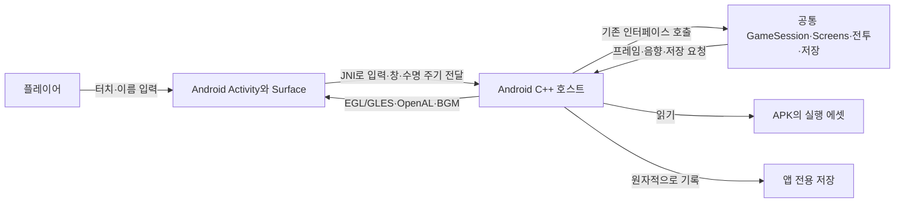

# HeavyMach 2 Android 개발 계획

기준은 PR #22가 병합된 `develop`의 `43ae492a56ea58881b84a36f51d385cc092bc981`이다. `feat/android-port-20261120`은 이 커밋에서 시작했다.

현재 공통 코어는 Apple 앱 파일을 수정하지 않고 Android용으로 빌드할 수 있다. 기존 루트 CMake를 그대로 사용해 NDK 26.3에서 `arm64-v8a`와 `x86_64`의 `HeavyMach2Core`를 컴파일했다. 두 정적 라이브러리의 전체 오브젝트를 각각 Android ELF 공유 라이브러리로 링크했고, 미해결 심벌을 허용하지 않는 검사도 통과했다. 이 검사는 API 24 도구 체인에서 수행했다. 대상 기기의 최소 SDK, APK, 그래픽·음향 출력과 전체 플레이는 아직 검증하지 않았다.

## 변경 금지 범위

Android 개발에서는 iOS·iPadOS가 사용하는 파일을 수정하지 않는다. 여기에는 `Apple/`과 `Sources/Platform/Apple/` 외에 `Sources/Core/`, `Sources/Assets/`, `Resources/`, `ThirdParty/`, 루트 `CMakeLists.txt`, Apple 빌드와 에셋 준비에 쓰는 `tools/`가 포함된다. Apple의 로컬 준비본과 빌드도 Android가 덮어쓰지 않는다.

Android 코드는 `Android/`와 `Sources/Platform/Android/`에 추가한다. 인게임 규칙은 기존 공통 C++ 라이브러리를 링크해 그대로 사용한다. 공통 API로 표현할 수 없는 동작을 발견하면 재현 조건, 호출 경계, 영향 기기를 기록한다. 공유 파일 수정이 필요한 경우에는 해당 문제를 별도 작업으로 분리한다.

구현 커밋과 병합 후보에서 기준 커밋과 Git 트리를 대조한다. 아래 검사는 새 플랫폼 경로와 이 계획 문서 외의 추적 파일에 추가, 삭제 또는 수정이 있으면 실패한다. 빌드 전후에는 작업 트리의 미커밋 변경과 새 파일도 확인한다. Git이 추적하지 않는 Apple 준비본은 파일별 상대 경로·SHA-256으로 전후를 대조한다. Gradle, CMake와 에셋 복사 작업의 출력은 Android 전용 디렉터리에 둔다.

```sh
git diff --exit-code 43ae492a56ea58881b84a36f51d385cc092bc981 HEAD -- . \
  ':(exclude)Android/**' ':(exclude)Sources/Platform/Android/**' \
  ':(exclude)docs/android-port-plan-20261120.md'
```

## 공통 코어와 Android 연결부



| 영역 | 현재 구현 | Android 작업 |
| --- | --- | --- |
| 앱·빌드 | [루트 CMake](../CMakeLists.txt)의 `HeavyMach2Core`와 Xcode의 일반·치트 타깃이 공통 코드를 사용한다. | `Android/`에 Kotlin Activity, JNI, Gradle 및 Android용 CMake 진입점을 둔다. `BUILD_TESTING=OFF`와 PIC를 Android 하위 빌드에서 설정하고 루트 타깃을 참조한다. 원래 C++20 및 부동소수점 옵션을 유지한다. |
| 상태·실행 순서 | [GameSession.hpp](../Sources/Core/Session/GameSession.hpp)와 [Screens.hpp](../Sources/Core/UI/Screens.hpp)가 공통 상태와 입력 API를 제공한다. [HM2GameRuntime.mm](../Sources/Platform/Apple/HM2GameRuntime.mm)이 프레임, 입력, 자원 변경 통지를 묶는다. | Android 호스트가 `SessionHost`와 `ScreensHost`를 구현한다. 같은 게임 스레드에서 tick, GUI 갱신, 출력 순서를 유지한다. 터치 소유권과 UI·월드 이벤트 순서는 기존 호출 계약을 따른다. |
| 화면·터치 | [DisplayLayout](../Sources/Core/Presentation/DisplayLayout.cpp)이 논리 화면과 600 경계를 계산한다. [Apple 렌더러](../Sources/Platform/Apple/HM2Renderer.mm)가 공통 `Frame`을 GLES1로 출력한다. | Surface에 EGL/GLES1 출력을 연결한다. 기기 유형과 창 크기·안전 영역을 별도로 입력한다. 표면 픽셀과 논리 좌표를 같은 변환으로 그리기·터치에 적용한다. 이전 창의 손가락 이벤트는 회전·표면 교체 때 취소한다. Android 포인터 ID 0은 공통 API에 전달할 때 0이 아닌 값으로 대응한다. 인게임 버튼·HUD는 공통 GPU 경로를 쓴다. [Android MotionEvent](https://developer.android.com/reference/android/view/MotionEvent) |
| 에셋·글꼴 | [ResourceAccess](../Sources/Core/Data/Resources.hpp)가 읽기 경계다. Apple은 준비된 Campaign HD와 CoreText 구현을 사용한다. | Android 전용 출력에만 기존 준비 명세와 파일을 읽어 패키징한다. `AAssetManager`로 읽고 기존 테이블·이미지 디코더와 부품 조립을 사용한다. `TextRasterizer`의 Android 구현은 한글, 글꼴 매핑, 글자 경계와 알파 비트맵을 확인한다. Trebuchet 계열 표지와 한국어 폰트의 사용 가능 여부·차이를 실제 이미지로 기록한다. [Android NDK Asset API](https://developer.android.com/ndk/reference/group/asset.html) |
| 음향 | `Sources/Core/Audio`에 PCM 및 OpenAL 효과음 경로가 있다. Apple BGM과 오디오 중단 연결은 플랫폼에 있다. | 기존 OpenAL Soft 소스를 Android 설정으로 빌드한다. A/B 비교에 재생 요청 순서, 같은 음원의 source 재사용, 실제 출력 샘플을 기록한다. BGM 재생과 Android 오디오 포커스는 별도 연결하며, 앱 재개 때 밀린 재생 요청이 실행되지 않게 한다. [Android 오디오 포커스](https://developer.android.com/media/optimize/audio-focus) |
| 저장·수명 주기 | `SaveData`가 28,204바이트 저장 포맷을 다룬다. 실제 저장과 HUD 편집 파일 쓰기는 호스트가 맡는다. | 앱 전용 저장 공간에 임시 파일 작성 후 원자적으로 교체하고 완료를 반환한다. 오류 시 기존 저장을 유지한다. 일반·치트 저장과 HUD 설정 공간을 분리한다. 백그라운드, 표면 소실, 프로세스 재시작을 따로 다룬다. [Android 앱 전용 저장](https://developer.android.com/training/data-storage/app-specific) |

HeavyMach 1과 MachDefense의 Android Gradle·CMake·EGL 구성을 읽어 적용 패턴을 확인했다. HM2의 지도·상점·진행·저장 규칙은 현재 공통 코어에서 가져온다. 원본 IPA와 사용자 저장은 패키징 입력이나 원격 산출물에 포함하지 않는다.

## 구현 전에 확인한 제약과 검증 방법

| 확인한 사실 | 구현과 통과 기준 |
| --- | --- |
| 기존 NDK 26.3으로 링크한 두 ABI의 시험용 라이브러리를 `llvm-readelf -lW`로 확인했다. 모든 `LOAD` 세그먼트가 4KB(`0x1000`) 정렬이다. 루트 CMake의 정적 코어에는 동시 치트 검사용 오브젝트도 들어 있다. | 첫 APK부터 Android 프로젝트에 NDK r28 이상과 호환되는 Gradle 플러그인(8.5.1 이상)의 실제 버전을 고정한다. 정식 앱은 코어에서 참조하는 오브젝트만 링크하고, 치트 실행 진입점은 별도 타깃에서 연결한다. 정식 링크 맵에서 검사용 오브젝트 제외를 확인한다. APK 안의 모든 64비트 `.so`에 대해 ELF 정렬을 검사하고 `zipalign -c -P 16 -v 4`로 APK도 확인한다. `adb shell getconf PAGE_SIZE`가 16384인 환경에서 설치·실행을 확인한다. [Android의 16KB 지원 안내](https://developer.android.com/guide/practices/page-sizes) |
| [에셋 준비 도구](../tools/prepare_campaign_assets.py)의 기본 출력은 Xcode가 읽는 `.local/prepared/Campaign/HD`다. 이 도구는 `.local/prepared/Campaign` 바깥의 출력을 거부한다. 현재 HD 준비본에는 명세를 포함해 파일 1,576개가 있다. | Android 빌드는 준비 도구를 실행하지 않는다. 검증한 준비본을 읽어 게임 자원만 `Android/app/build/generated/assets` 아래에 복사한다. 입력이 없거나 명세가 다르면 경로와 누락 파일을 표시한다. APK에서 실제 항목을 다시 읽어 상대 경로·대소문자·내용 해시를 대조한다. 휴대전화 상점은 `PhoneShopHangar.jpg`, 태블릿은 해당 기기의 기존 상점 배경을 사용하고 첫 진입 화면과 버튼 입력을 확인한다. |
| [Apple 화면 루프](../Sources/Platform/Apple/HM2SourceView.mm)는 60Hz를 요청하고 호출당 한 번 게임을 갱신한다. [GameClock](../Sources/Core/Simulation/GameClock.hpp)은 한 번 갱신할 때마다 고정량을 더한다. | Android 호스트는 활성 시간에 초당 60회 게임을 갱신한다. 화면을 그리는 횟수와 게임 갱신 횟수를 분리하고, 복귀 시 일시정지 시간을 버린다. 60·90·120Hz의 10초 입력 기록에서 각각 600번 갱신되는지 검사한다. 같은 틱에 이동·점프·사격 입력을 넣고 최종 좌표, 점프 횟수와 SP, 발사 횟수를 비교한다. 실제 기기 또는 에뮬레이터에서는 관측한 주사율과 게임 틱을 함께 기록한다. [Android 프레임 시각](https://developer.android.com/reference/android/view/Choreographer.FrameCallback) |
| [GameSession](../Sources/Core/Session/GameSession.cpp)은 슬롯 생성 시각을 저장하고 전장 진입 때 호스트 시계로 난수를 다시 초기화한다. 저장 인코딩에도 호스트 시계를 사용한다. | 양쪽 치트 검사의 입력에 시작 저장, 난수 시드, 틱별 입력, `unixTime()`과 `absoluteTimeLow()` 반환 순서를 기록한다. 같은 시나리오에서 세 슬롯의 위치·장비·소지금·임무와 피해량을 대조한다. 실제 시계를 쓴 정식판은 재실행 뒤 디코딩한 진행 상태를 비교한다. |

## 구현과 통과 기준

1. **첫 실행**
   Android CMake에서 공통 라이브러리를 참조해 JNI 앱을 빌드한다. Android 전용 에셋 준비를 연결하고 타이틀 → 슬롯 → 기지 → 첫 전장 → 저장 재개까지 실행한다. 파일 누락과 읽기 실패를 실제 오류로 남긴다.
2. **입력과 화면**
   가로 휴대전화와 세로 태블릿에서 동일한 시작 저장으로 UI·월드 입력을 대조한다. 카메라, 이동 경로 덮어쓰기와 더블탭 점프, 다른 손가락의 HUD 조작, 회전·컷아웃·제스처 영역, 599/600 논리 크기 전환을 검사한다. 실제 Surface 크기와 인셋으로 화면을 다시 계산하는지 확인한다. 표시된 버튼의 실제 터치, 하단 HUD의 잘림·겹침과 Skyway 연속 프레임을 기록한다. [Android 16 화면과 창 동작](https://developer.android.com/about/versions/16/behavior-changes-16#adaptive-layouts)
3. **전투·거래·진행**
   Android 치트 앱의 앱 ID와 저장을 일반 앱에서 분리한다. 공습·퀵 슬롯·BOT·장비, 인벤토리 75칸과 마지막 줄, 레이저 공습 구매, 사령부 의뢰와 설원 14방향 이동을 실행한다. 기존 Apple 검증과 시작 저장·입력·난수 조건을 맞추고 발사·피해·아이템·포털·저장 결과를 비교한다. Android 전용 행이나 별도 게임 규칙을 추가하지 않는다.
4. **일반 APK 후보**
   ARM64 기기 또는 에뮬레이터와 준비된 에뮬레이터 ABI에서 일반 진행, 재시작, 백그라운드 복귀와 음향 중단을 검증한다. 전장에서 EGL 컨텍스트를 잃은 뒤 Android 렌더러의 기존 텍스처 핸들을 폐기하고 현재 월드·메뉴·텍스트를 다시 올린다. 전투 세션과 저장 슬롯을 유지한 채 같은 위치·HP·HUD로 복귀하는지 확인한다. 패키지에 치트 실행 진입점이 없는지 검사하고 ABI·네이티브 라이브러리와 APK의 16KB 페이지 정렬을 확인한다. Android 후보의 검증과 기기 설치 또는 배포를 구분한다. [Android 16KB 페이지 크기 지원](https://developer.android.com/guide/practices/page-sizes)

단계마다 Android 전용 변경을 커밋하고, 기준 커밋·산출물 해시·에뮬레이터 또는 기기·사용한 시작 저장의 종류를 기록한다. iPhone·iPad는 병합 커밋의 기존 검사 결과를 비교 기준으로 쓴다. 화염방사기와 근접 공격은 [후속 투두](todo.md)에 남긴다.
