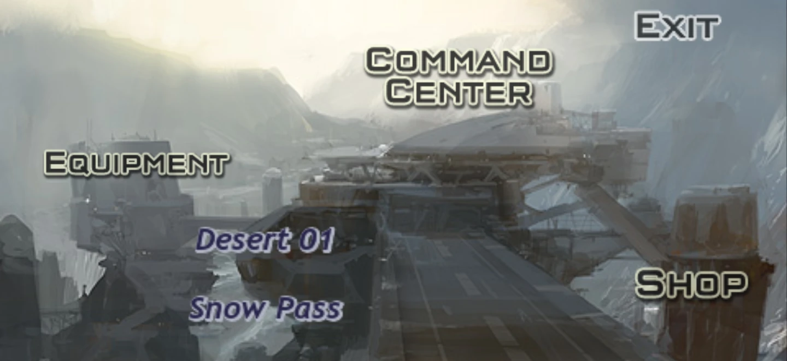
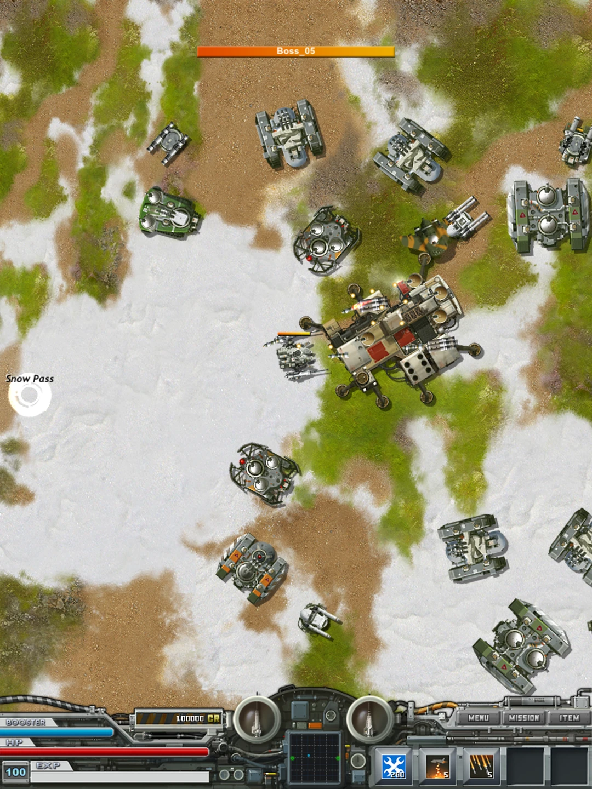
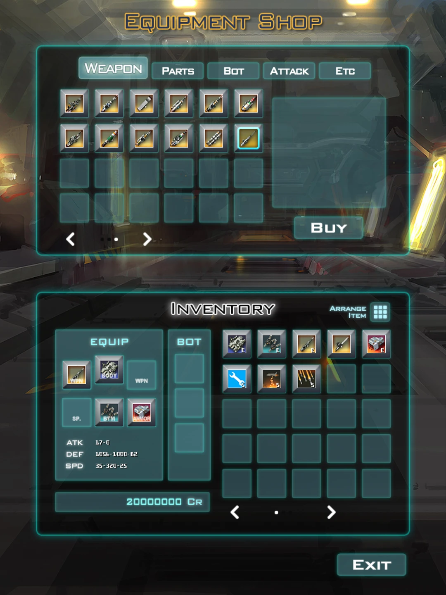
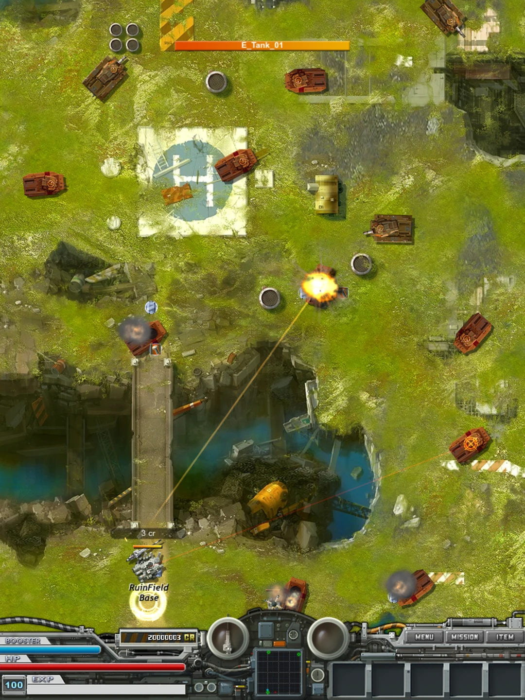

# What HeavyMach 2 restores and adds

[한국어](../../public/features.md) · [Project overview](../../../README.en.md) · [Developer’s statement in Korean](../../RESTORATION.md) · [Development history](development-history.md)

In HeavyMach 2, you assemble a mech and draw paths for it to follow on the battlefield. You fight enemies for items, change equipment, travel between bases, and take missions from the Command Center. The restoration shares the data and behavior of iPad HD 1.0.3 across platforms. The iPhone display and controls were also checked against regular edition 2.0.1. [Differences between the regular and HD editions](../../original-phone-hd-separation.md)

## Restored from the original

### Movement, combat, and mech assembly

Tap the ground to move or draw a path with several waypoints. Double-tap to dash with the booster. Weapon range, firing intervals, projectiles, and damage follow the original tables and runtime behavior. In combat, you can switch weapons, use repair kits or air strikes, and deploy BOTs. [How to play](quick-play.md) · [Movement and camera checks](../../iphone-module-audit-20261118.md) · [Weapon data and muzzle positions](../../weapon-data-restoration-20261110.md)

Mech bodies, legs, and weapons attach at the points defined in the original data. The mounted weapon's muzzle and its parts turn as the mech moves. The resource pipeline prepares part shadows and animations, and the renderer reuses the resulting textures and atlases. [Graphics and audio evidence](../../graphics-audio-fidelity-20261110.md)

### Bases, portals, and progression

HD 1.0.3 contains five bases, 38 battlefields, and 90 portal records. The restoration reads the original portal and arrival positions and uses the existing mission conditions for routes that unlock through missions. At bases you can take Command Center missions, trade at shops, service the mech, and swap equipment. Command Center missions can be accepted, completed, and reported to claim rewards. Items and progress are saved in three slots. [Original maps and item sources](../../original-unused-content-20261119.md) · [Mission completion and rewards](../../completed-missions-restoration-20261111.md) · [Save format](../../save-transfer.md)

The base and Command Center menus follow the original button artwork and coordinates. iPhone and iPad select the original artwork for their respective layouts, and the same C++ code handles input. The HD shop shows 24 goods per page and the inventory holds 25 slots per page. On iPhone, an inventory page is shown in groups of 20 and five. The iPhone shop and equipment screens use the edited background described in the troubleshooting notes. [Artwork and screen exceptions](../../design-and-asset-rules.md) · [iPhone inventory pages](../../iphone-inventory-last-page-20261120.md)

### Sound effects and music

The game reads the original WAV effects as PCM and loads them into OpenAL buffers and sources. Shots and impacts reuse the prepared sources. Background music uses each platform's playback path. The HD sniper rifles use the same bytes for `Wpn_Laser.wav` as HeavyMach 1.13. The test build equipped and fired those rifles and verified sample playback. [Laser audio investigation](../../original-unused-content-20261119.md#치트-앱에서-난-레이저음) · [How all three games use assets](../../code-document-fixes-20261121.md)

## My contributions

I set the scope of the original-game investigation, chose which content to connect, and recorded problems I saw on physical devices. I worked with Codex on the implementation, tools, and automated checks. [Developer’s statement in Korean](../../RESTORATION.md)

### Opening White Mountain to players

I asked for another look at White Mountain and the snowfield artwork I had never seen in the original game. The six regular and HD builds we examined included artwork and facility menus for White Mt. Base. HD 1.0.0 also included six snowfield images without registered maps. We found no portal to White Mountain or snowfield placement, collision, or mission records in those builds. [Original files and findings by edition](../../original-unused-content-20261119.md#화이트마운틴과-전장)

I had the six images put to use as battlefields, with the base and fields connected through the existing portal, Command Center, and reward rules. You can enter White Mountain from Desert 01 and progress through the snowfields starting with Snow Pass. Snow Fort gained collision boundaries for its rocks and structures. Bosses 05 through 08 were placed farther into their fields. I also pointed out that there were too few regular enemies. Using the original Wasteland and Desert fields' 13 to 23 units as a reference, we placed 14 to 20 tanks, turrets, and aircraft in each snowfield. [Maps, portals, and boss missions](../../white-mountain-implementation-20261119.md) · [Enemy placement](../../campaign-and-ipad-followup-20261120.md#설원-적-배치-결과)

Snow Pass, Snow Basin, and the other snowfields use the original stage font path for area names and portal labels. The base exits also follow the original artwork, selected state, and two-tap activation. We installed the regular build and the iPad progress save on both physical Apple devices. I confirmed that White Mountain opened on the iPhone. Simulators and host tests checked all 14 portal directions and the individual Command Center missions. [Exit, font, and physical installation record](../../white-mountain-dual-release-20261120.md)

The portal in Desert 01 leads to White Mt. Base. Tap **Snow Pass** once to select the exit and again to leave for the snowfields. **Desert 01** goes back to the desert. The screenshot comes from the test build on an iPhone simulator. [Desert portal and snowfield screenshots](gameplay-gallery.md#white-mountain-base-and-snowfields)

Complete the original Boss 04 mission to unlock the Boss 05 mission at the Command Center. Boss 05 spawns when you approach within 240 game units of its position inside Snow Basin. Defeat it and report back to receive 300,000 Cr and 300,000 XP. The screenshot shows combat in the test build on an iPad simulator. The gallery also shows the tanks and turrets in Snow Fort and the Boss 05 acceptance and reward screens. [Boss and reward conditions](../../white-mountain-implementation-20261119.md#2단계-보스와-무장) · [Boss mission screenshots](gameplay-gallery.md#white-mountain-boss-fight)

### Bringing unused weapons, enemies, and BOTs into play

I had four unused sniper rifles and 21 LS-series weapons brought into normal progression through shops and drops, using their original equip levels, firing definitions, artwork, and sounds. Four boss missions and five regular enemies were connected to the snowfields. Existing weapon types were used to define firing points and damage for unarmed aircraft. The laser air strike and three Item Picker BOTs became usable too. The records show the original values and artwork and the acquisition, encounter, and mission conditions added in the restoration. The test builds on both Apple simulators checked weapon firing, damage, and audio playback, and verified item delivery by the BOTs. [Weapons, enemies, and BOTs](../../white-mountain-implementation-20261119.md#2단계-보스와-무장) · [Runtime results](../../white-mountain-implementation-20261119.md#최종-앱-확인)

I asked that air strikes defeat the main enemy tanks in one or two hits at the level you would normally reach a field. The original prices are 20 Cr for bombs, 40 Cr for missiles, 30 Cr for lasers, and 100 Cr for nukes. Damage scales using linear interpolation between HP values by level. In 32 shared combat checks, a single strike aimed at the center defeated the target tank. [Air-strike scaling and test conditions](../../campaign-and-ipad-followup-20261120.md#공습-레벨-보정)

The Sn-IGn sniper rifle (10501) is stocked by shops at the appropriate level and can drop from Boss 05. LS-series weapon 10311 is a rare drop from the Tank_L02 loot group. The test build on an iPad simulator checked the Sn-IGn listing, then equipped and fired both weapons and checked damage. [Shop and drop data](../../../Resources/Campaign/items.json) · [Shop and combat screenshots](gameplay-gallery.md#sniper-rifles-and-ls-weapons)

In the latest shop check, one **Laser Air-Strike** cost 30 Cr at displayed level 22. It was dragged from the battlefield inventory into a quick slot, then used by tapping the slot and the target. Item Picker D through F use Picker C's collection behavior. They find loot from defeated enemies and bring it to the player. The screenshot shows the iPad simulator test build just after Item Picker D delivered an item. [Air-strike and BOT screenshots](gameplay-gallery.md#laser-air-strike-and-item-picker-bots) · [Level 22 shop check](../../campaign-and-ipad-followup-20261120.md)

### Android, PWA, Mac, and recovery codes

I had Android reuse the C++ modules without changing the files used by iOS or iPadOS. Platform hosts connect the display, touch input, audio devices, and storage. The web build compiles the same game core and menus to Wasm, and Tauri bundles that build into a Mac app. We used HeavyMach 1's first Wasm PR and the MachDefense port as references. Android, recovery codes, PWA, and Tauri are in the public repository. Release versions vary by platform. [HeavyMach 1’s first Wasm PR](https://github.com/gelb2/HeavyMach/pull/24) · [Versions and releases](../../public/release-policy.md) [Android implementation](../../../Android/README.md) · [Web source comparison with HeavyMach 1](../../pwa-wasm-audit-20261120.md) · [Mac build](../../../Desktop/Tauri/README.md)

I added recovery codes to move progress, items, and experience between devices. They export and import all three slots. The receiving app backs up its existing save before replacing it. The regular and test Android apps loaded three existing iPad slots to check command and shop behavior. Separate records cover code import and export on the Apple simulator runtime, Android emulator, PWA, and Mac. [Recovery codes and platform checks](../../save-transfer.md) · [Galaxy play with iPad progress](../../../Android/검증-20261120.md#ipad-사용자-저장과-갤럭시-플레이)

## Troubleshooting

[Troubleshooting](troubleshooting.md) covers the iPhone shop, jump and Skyway changes, and the laser air-strike listing in the iPad shop.

## Remaining work

Flamethrowers, melee attacks, EMP, and defensive BOTs are future work. The original-game investigation records the definitions and assets we found. Quest completion notifications and collection rewards still need checks, along with PWA installation and save transfer on physical phones and tablets, hands-on use of the latest Tauri portrait window, and a final comparison with the original HD release. [Pending skills and defensive BOTs](../../campaign-and-ipad-followup-20261120.md#후속-스킬과-방어형-bot-계획) · [Current checklist](../../todo.md#현재-체크--2026-11-21)
