# HeavyMach 2 플레이 화면과 영상

[English](../en/public/gameplay-gallery.md)

[플레이 방법](quick-play.md) · [원작 복원과 추가 작업](features.md)

## iPad 플레이 녹화

첫 GIF는 연못 사이에서 이동 목표를 정하고 주변 전차와 교전하는 장면이다. 두 번째 GIF는 해안가에서 이동 경로를 그리며 적과 포탄을 주고받는 장면이다. 2026년 11월 12일 사용자 녹화에서 각각 연속 8초를 발췌했다. [영상 구간과 해시](media/player-captures-20261121/sources.json)

## iPhone 사령부와 전장

2026년 11월 14일 사용자가 iPhone 가로 화면에서 찍었다. 사령부의 임무 목록, Skyway Base 포털 주변의 전장, 전장 위에 연 시스템 메뉴 순이다.

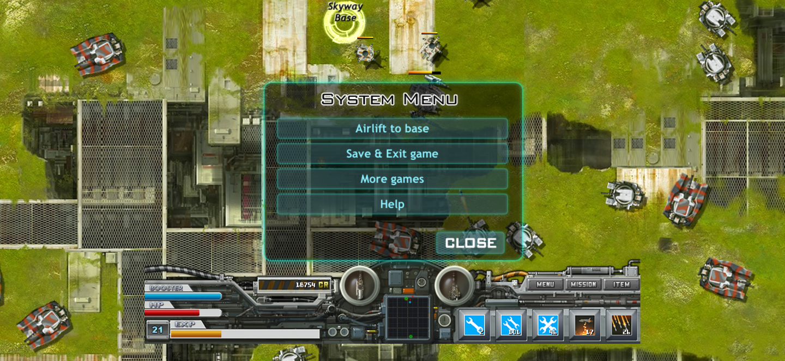

## iPhone의 이동 경로와 상점

Ruin Field에서 이동 경로를 다시 지정하는 장면이다. 초록색 점과 선이 이동 경로를 표시한다. iPhone Air 시뮬레이터에서 실제 OS 입력으로 조작한 Source 앱의 녹화다. 원본 녹화의 36.8~42.9초를 가로 방향으로 돌려 사용했다. [MP4 · 6.1초](media/gameplay-20261121/iphone-route.mp4) · [입력 재현과 수정 기록](../iphone-module-audit-20261118.md)

아래는 Wasteland 상점의 상품 목록·인벤토리·페이지 버튼이 보이는 iPhone 시뮬레이터 캡처다. [상점 원본 좌표 대조](../iphone-shop-reference-coordinates-20261119.md)

## iPad 세로 전장

iPad Pro 11형 시뮬레이터에서 새 프로필로 기지·사령부·전장을 오가는 일반 앱 검사를 했다. 영상은 Ruin Field의 세로 시야와 기본 HUD가 보이는 연속 구간이다. [MP4 · 12초](media/gameplay-20261121/ipad-field.mp4) · [기종별 HUD와 조작 검사](../campaign-and-ipad-followup-20261120.md#ipad-모델별-hud)

## 화이트마운틴 기지와 설원

Desert 01 화면 오른쪽 위의 **White Mt. Base** 포털이 기지 입구다. 이 장면은 iPad Pro 13형(M4) 시뮬레이터 치트판에서 찍었다. 기지 출구와 Snow Pass 도착은 iPhone 시뮬레이터 치트판의 화면이다. 기지의 **Desert 01**은 사막으로 돌아가는 선택이고 **Snow Pass**는 첫 설원으로 나가는 선택이다. [포털 14방향과 실기기 설치 기록](../white-mountain-dual-release-20261120.md)

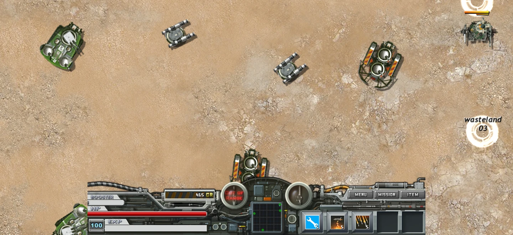

같은 실행의 Snow Fort 도착 화면이다. 새로 배치한 전차와 포탑이 있으며, 바위에는 충돌 경계를 만들었다. 맵 데이터에서 비행체 위치를, 공통 코어 기록에서 비행체 발사와 플레이어 피격을 확인할 수 있다. [설원 적 배치](../campaign-and-ipad-followup-20261120.md#설원-적-배치-결과) · [사격·피격 검사](../white-mountain-implementation-20261119.md#단계별-실행-결과)

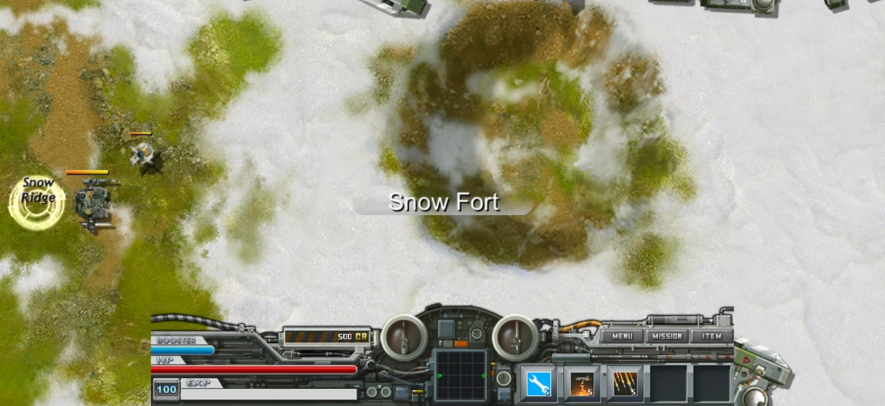

아래는 같은 iPhone 시뮬레이터 치트판에서 Snow Field, Snow Ridge, Snow Valley에 도착한 모습이다. Snow Basin은 다음 보스전에서 볼 수 있다.

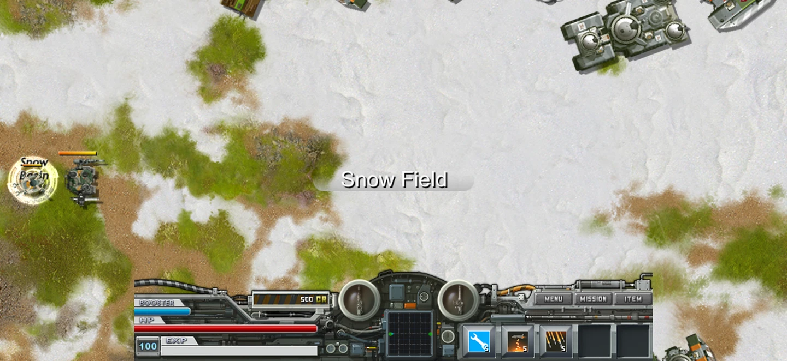

iPad Pro 13형(M4) 시뮬레이터 치트판에서 Snow Pass의 비행체 E_Plane_01에 접근했다. 아래는 비행체의 첫 발사 시점이다. 화면 중앙 오른쪽의 주황색 비행체에 발사 섬광이 보인다.

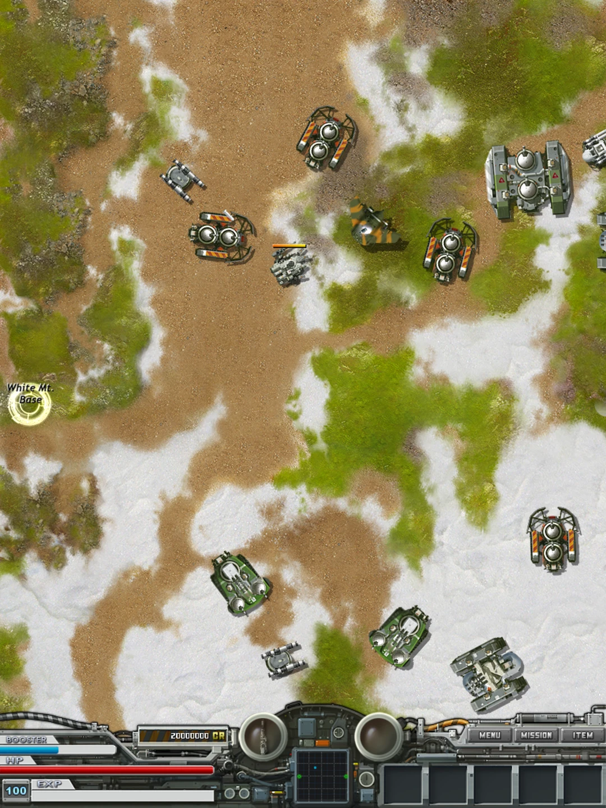

## 화이트마운틴 보스전

iPhone 17 Pro 시뮬레이터의 치트 앱에서 SnowBasin 보스 의뢰를 수락하고 전장으로 들어갔다. Boss 05의 체력 표시와 사격 중인 포탑이 보인다. [의뢰·출현·격파·보상 검사](../white-mountain-implementation-20261119.md#단계별-실행-결과)

아래 세 장은 iPad 시뮬레이터 치트판에서 찍었다. 사령부에서 Boss 05 의뢰를 수락하고, Snow Basin 안쪽에서 보스와 교전한 뒤, 사령부에 격파를 보고해 보상을 받는다.

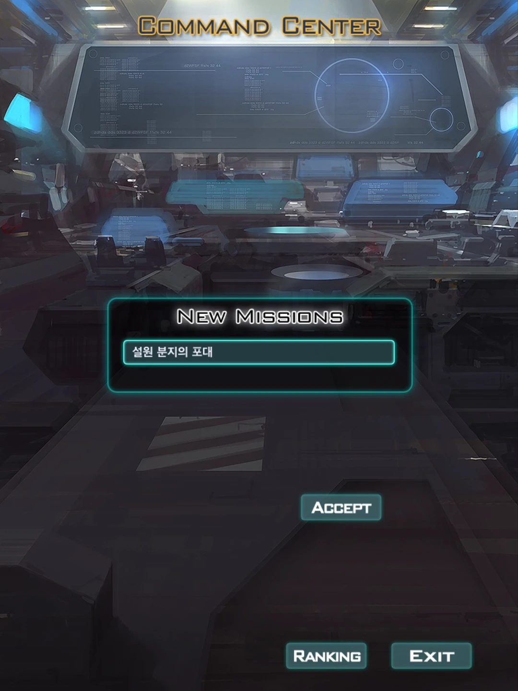  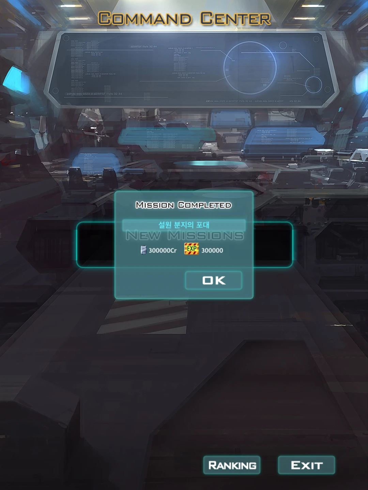

## 저격총과 LS 무기

iPad 시뮬레이터 치트판에서 Sn-IGn(10501)가 진열된 상점과, Ruin Field에서 Sn-IGn와 LS 계열 10311을 각각 장착해 발사한 화면이다. 이 치트 검사는 장착·발사·피해를 재현했다. 일반 플레이의 Sn-IGn 상점·Boss 05 드롭과 10311의 Tank_L02 드롭 조건은 데이터에서 확인할 수 있다. [상점·드롭 데이터](../../Resources/Campaign/items.json) · [무기 검사](../white-mountain-implementation-20261119.md#단계별-실행-결과)

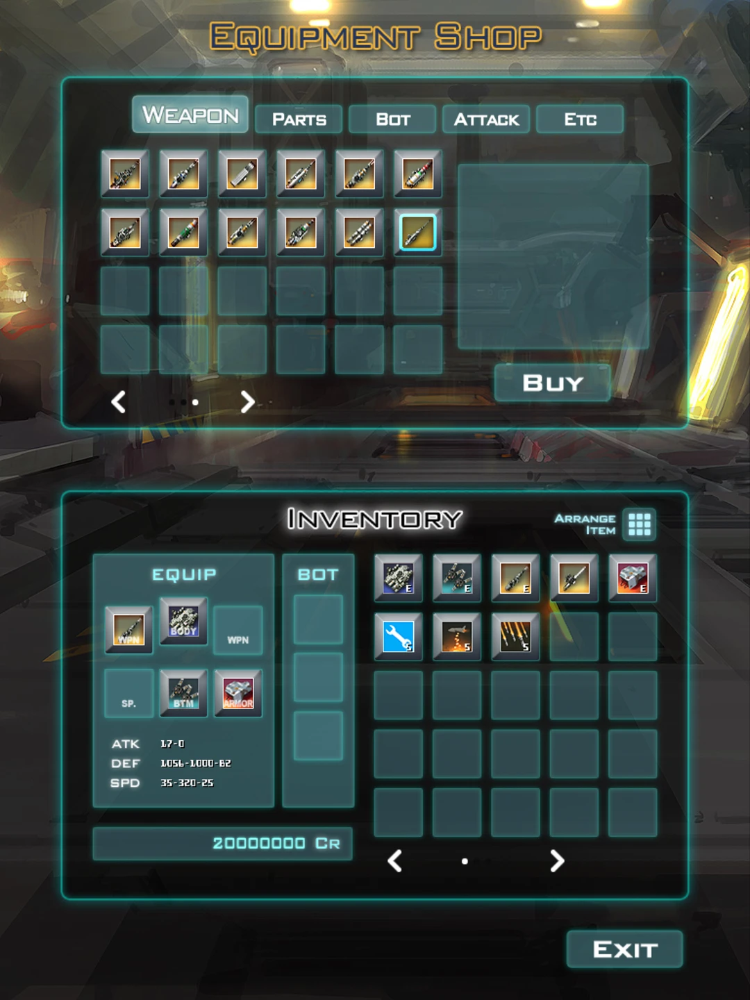  

별도 iPad Pro 13형(M4) 시뮬레이터 치트판에서 Ruin Field의 E_Tank_02를 실제 전투로 격파했다. 난수 시드를 고정해 공개 드롭 표의 희귀 결과를 재현했다. 아래는 LS-D(10311)가 떨어진 순간과 획득한 무기를 인벤토리에서 고른 모습이다.

 

## 레이저 공습과 수집 BOT

iPad 시뮬레이터 치트판에서 레벨 22 상점의 특수공격 목록에 진열된 **Laser Air-Strike**를 30 Cr에 샀다. Ruin Field에서 퀵 슬롯에 등록한 화면과, 슬롯에서 한 개를 써 공습이 시작된 화면이 이어진다. [레벨별 공습 조정과 구매 검사](../campaign-and-ipad-followup-20261120.md#공습-레벨-보정)

  

iPad Pro 13형(M4) 시뮬레이터 치트판의 같은 Ruin Field 실행에서 네 장을 찍었다. 첫 BOT 칸에 장착한 Item Picker D, BOT이 전리품에 접근한 순간, 전달 직후 전장, 전달 후 인벤토리 순이다. 전달 뒤 인벤토리의 잔액은 3 Cr 늘었다. 앞선 별도 검사에서는 Picker E와 F도 각각 전리품 한 개를 전달했다. [수집형 BOT 실행 기록](../white-mountain-implementation-20261119.md#단계별-실행-결과)

 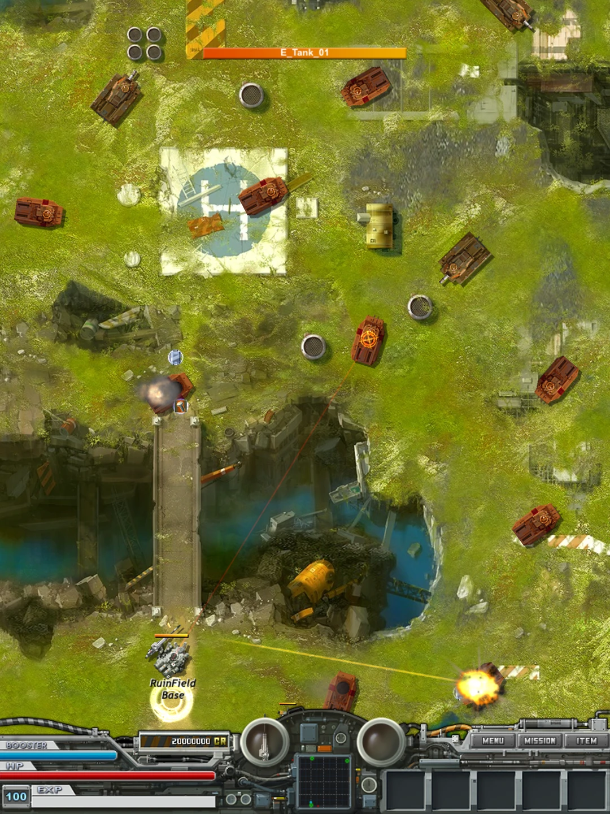

 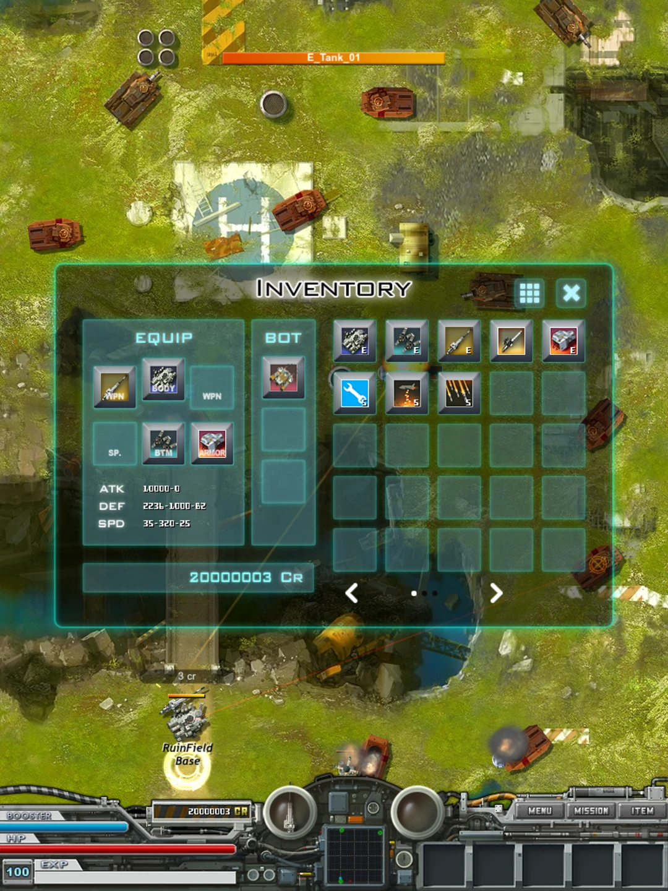

## 갤럭시 정식판과 Mac 설치형 PWA

갤럭시 정식판의 검사용 새 슬롯에서 Ruin Field에 들어가 지면을 눌러 이동했다. 아래 캡처에는 메크 앞의 이동 목표와 세계 위에 배치된 HUD가 보인다. [갤럭시 정식·치트판 실행](../../Android/검증-20261120.md)

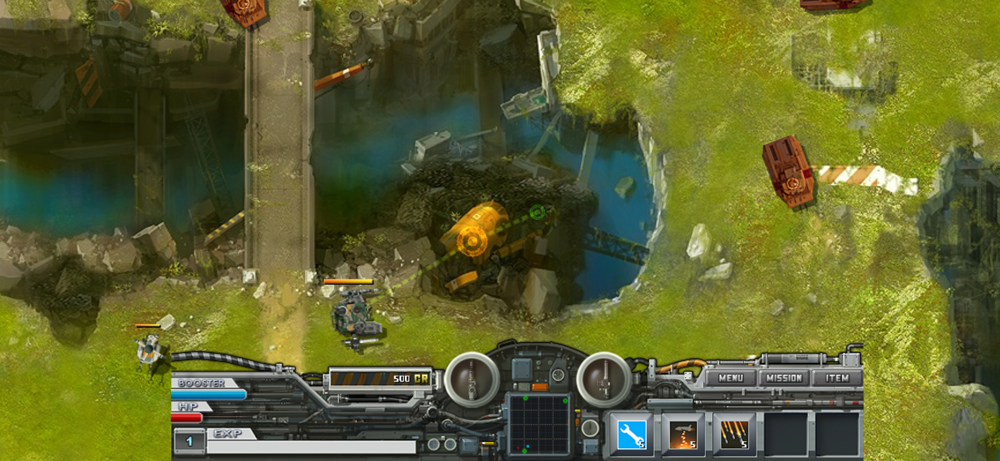

Mac Chrome에 설치한 치트 PWA에서도 같은 Ruin Field에서 전투를 확인했다. 기관총·미사일·피격·폭발음은 브라우저 출력 버퍼에서 확인했다. [설치형 PWA의 음향 검사](../code-document-fixes-20261121.md#실행-근거)

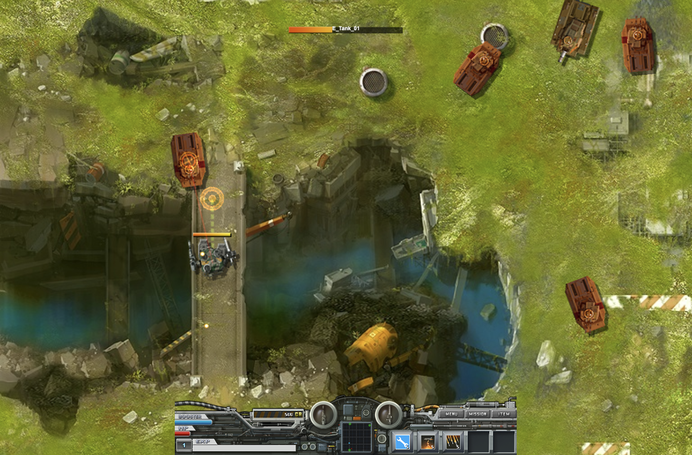

두 MP4는 무음 시뮬레이터 녹화에서 발췌했다. [원본 경로·시점·해시](media/gameplay-20261121/sources.json)
