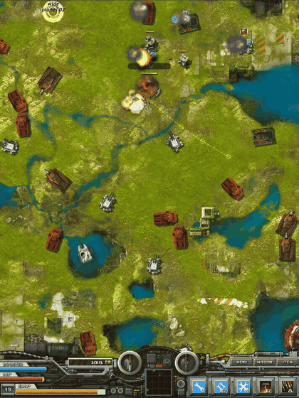
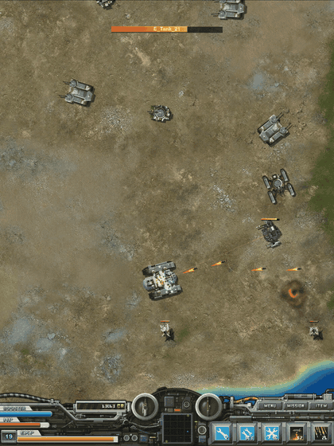
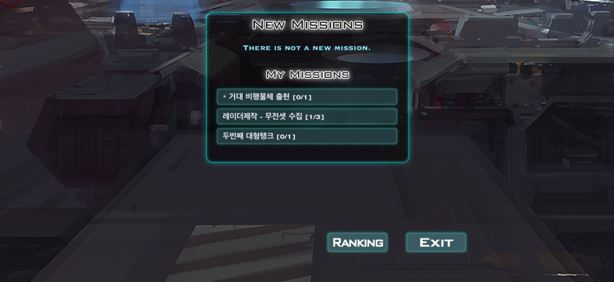
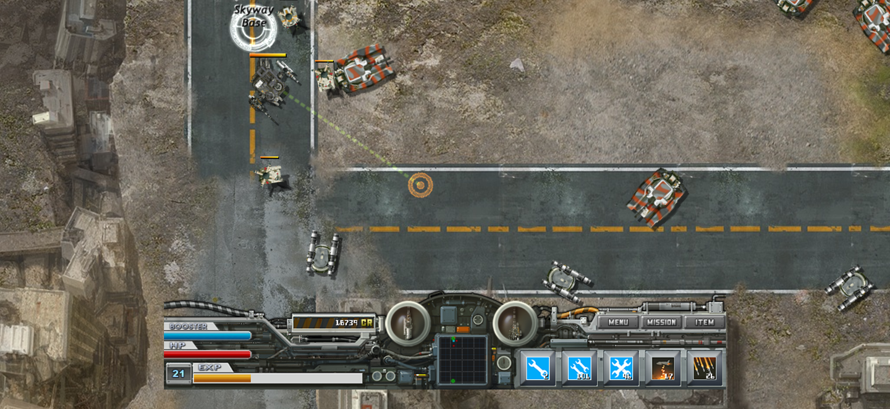
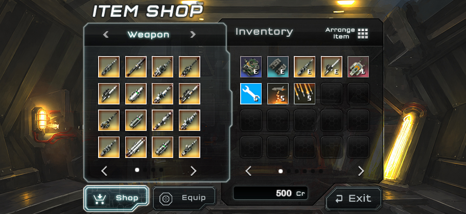
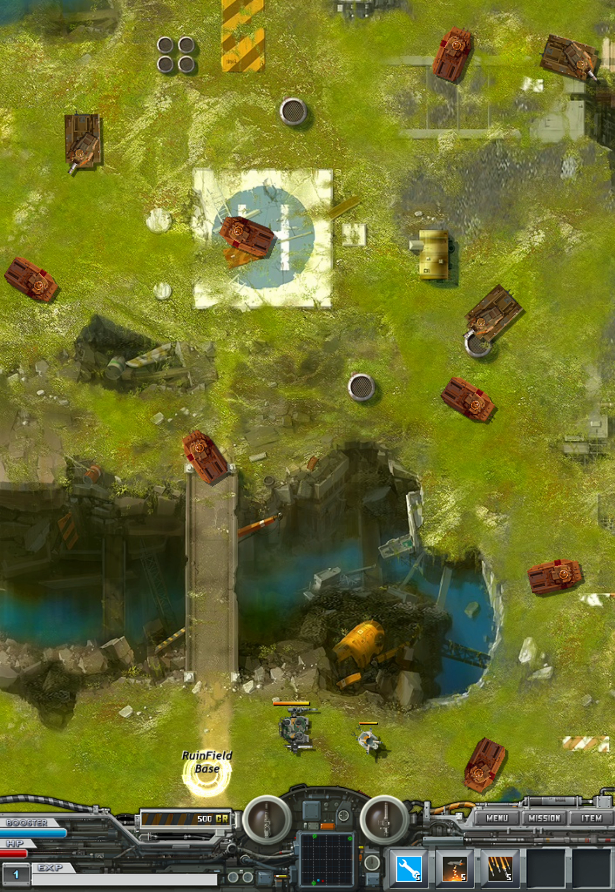
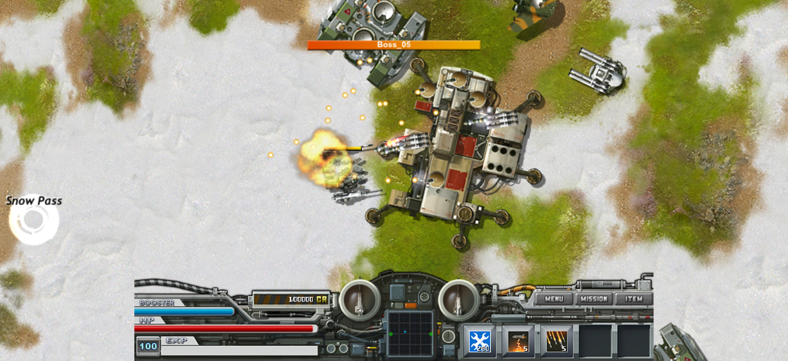

# HeavyMach 2 플레이 화면과 영상

[플레이 방법](quick-play.md) · [원작 복원과 추가 작업](features.md)

## iPad 플레이 녹화

첫 GIF는 연못 사이에서 이동 목표를 정하고 주변 전차와 교전하는 장면이다. 두 번째 GIF는 해안가에서 이동 경로를 그리며 적과 포탄을 주고받는 장면이다. 2026년 11월 12일 사용자 녹화에서 각각 연속 8초를 발췌했다. [영상 구간과 해시](media/player-captures-20261121/sources.json)

## iPhone 사령부와 전장

2026년 11월 14일 사용자가 iPhone 가로 화면에서 찍었다. 사령부의 임무 목록, Skyway Base 포털 주변의 전장, 전장 위에 연 시스템 메뉴 순이다.

## iPhone의 이동 경로와 상점

Ruin Field에서 이동 경로를 다시 지정하는 장면이다. 초록색 점과 선이 이동 경로를 표시한다. iPhone Air 시뮬레이터에서 실제 OS 입력으로 조작한 Source 앱의 녹화다. 원본 녹화의 36.8~42.9초를 가로 방향으로 돌려 사용했다. [MP4 · 6.1초](media/gameplay-20261121/iphone-route.mp4) · [입력 재현과 수정 기록](../iphone-module-audit-20261118.md)

아래는 Wasteland 상점의 상품 목록·인벤토리·페이지 버튼이 보이는 iPhone 시뮬레이터 캡처다. [상점 원본 좌표 대조](../iphone-shop-reference-coordinates-20261119.md)

## iPad 세로 전장

iPad Pro 11형 시뮬레이터에서 새 프로필로 기지·사령부·전장을 오가는 일반 앱 검사를 했다. 영상은 Ruin Field의 세로 시야와 기본 HUD가 보이는 연속 구간이다. [MP4 · 12초](media/gameplay-20261121/ipad-field.mp4) · [기종별 HUD와 조작 검사](../campaign-and-ipad-followup-20261120.md#ipad-모델별-hud)

## 화이트마운틴 보스전

iPhone 17 Pro 시뮬레이터의 치트 앱에서 SnowBasin 보스 의뢰를 수락하고 전장으로 들어갔다. Boss 05의 체력 표시와 사격 중인 포탑이 보인다. [의뢰·출현·격파·보상 검사](../white-mountain-implementation-20261119.md#단계별-실행-결과)

## 갤럭시 정식판과 Mac 설치형 PWA

갤럭시 정식판의 검사용 새 슬롯에서 Ruin Field에 들어가 지면을 눌러 이동했다. 아래 캡처에는 메크 앞의 이동 목표와 세계 위에 배치된 HUD가 보인다. [갤럭시 정식·치트판 실행](../../Android/검증-20261120.md)

Mac Chrome에 설치한 치트 PWA에서도 같은 Ruin Field에서 전투를 확인했다. 기관총·미사일·피격·폭발음은 브라우저 출력 버퍼에서 확인했다. [설치형 PWA의 음향 검사](../code-document-fixes-20261121.md#실행-근거)

두 MP4는 무음 시뮬레이터 녹화에서 발췌했다. [원본 경로·시점·해시](media/gameplay-20261121/sources.json)
